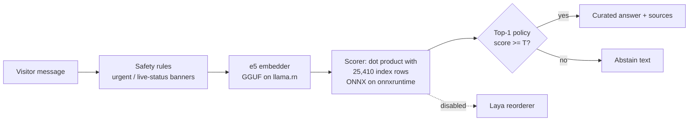

# Los Nevados offline assistant

An Android app for visitors of Parque Nacional Natural Los Nevados (Colombia) that answers park questions in Spanish with no network, in airplane mode. It never generates text: every reply is a curated, sourced answer from the park knowledge base, picked by an on-device embedding model, or an honest "I don't have that" when nothing matches well enough.

- App: Expo SDK 58, React Native 0.88 (new architecture, Hermes), TypeScript, Expo Router. Target: Android arm64.
- Knowledge: 843 curated entries in 15 sections, each with sources (`data/knowledge/sections/`).
- Reference device: Samsung Galaxy A24 (Helio G99, 90 Hz).

## How a question is answered



The retrieval architecture (vector gateway, one gate per sector, per-gate strategies, shared embedding model, decision layer): [`docs/retrieval-architecture.md`](docs/retrieval-architecture.md). App, assets and renderers: [`docs/architecture.md`](docs/architecture.md). How every folder, script and model connects, and what to redo when one changes: [`docs/system-map.md`](docs/system-map.md).

## Repository map

| Path | What |
|---|---|
| `mobile/` | The app. Developer guide: [`mobile/README.md`](mobile/README.md) |
| `data/knowledge/sections/` | The knowledge base (source of truth). Changed only through the `add-park-knowledge` skill |
| `data/knowledge/app/` | App layer on top of the sections: natural replies, extra queries, hubs ([README](data/knowledge/app/README.md)) |
| `data/knowledge/eval_v2/` | Sealed evaluation splits |
| `experiments/nlu/` | Current exporter (`export_nlu.py`), e5 fine-tune (`colab_train.py`) and evaluation scripts |
| `experiments/laya/` | Shared export library (`export_knowledge.py`) and the Laya reorderer track (off) |
| `research_notes/` | Research and curation evidence behind every knowledge entry |
| `.agents/skills/add-park-knowledge/` | Knowledge editing skill (`.claude/skills/add-park-knowledge` links to it) |
| `src/nevados_bench/`, `tests/` | Legacy Python: the world/FSM export that the settings screen still reads, and its tests |
| `docs/` | Contracts and architecture; `docs/history/` keeps superseded plans and reports |

Not in git (see `.gitignore`): the model files in `models/` (~1.4 GB; only its README is tracked), `results/`, `mobile/android/` (generated by Expo), virtualenvs and caches.

## Run it from a fresh clone

Needs Node 22, JDK 21, the Android SDK (with `ndk;27.1.12297006` and `platforms;android-37`), `adb`, and an arm64 Android phone with USB debugging. Full tool table: [`mobile/README.md`](mobile/README.md#prerequisites).

1. **Get the model files.** They are not in git. Ask a maintainer for the model files (about 1.4 GB) and copy them into `models/` following the tree in [`models/README.md`](models/README.md). Check them: `sha256sum -c models.sha256`
2. **Install JS dependencies:** `cd mobile && npm install`
3. **Generate the Android project** (ignored by git): `npx expo prebuild --platform android`, then point Gradle at your SDK: write `sdk.dir=<your sdk path>` in `mobile/android/local.properties`. If `ANDROID_HOME` and `ANDROID_SDK_ROOT` are both set to different paths, Gradle refuses to build; unset one.
4. **Build and install the debug app:** `cd android && ./gradlew assembleDebug -PreactNativeArchitectures=arm64-v8a && adb install -r app/build/outputs/apk/debug/app-debug.apk`
5. **Copy the models to the phone and start the app:** from `mobile/`, run `scripts/push-knowledge.sh`, then `npx expo start` and `adb reverse tcp:8081 tcp:8081`, and open the app.

Optional, a standalone app with no Metro: `cd mobile/android && ./gradlew assembleRelease -PreactNativeArchitectures=arm64-v8a`, then `adb install -r app/build/outputs/apk/release/app-release.apk` **over** the debug install, which keeps the pushed models. A fresh release install has no models (see Known limits).

### Model files

| Path under `models/` | Size | Needed for |
|---|---|---|
| `knowledge/e5-nlu-ft4-f16.gguf` | 563 MB | The app (query embedder). Cannot be rebuilt from git: keep a backup |
| `knowledge/index.f32.bin` | 78 MB | The app (index vectors). Rebuildable from the GGUF with `export_nlu.py` |
| `knowledge/index_scorer.onnx` | 78 MB | The app (native scorer). Rebuilt with the vectors |
| `laya/` (int8 ONNX 699 MB + tokenizer) | 700 MB | Optional: the Laya reorderer, off in the app (`push-knowledge.sh --with-laya`) and Python experiments |

The app checks each file's byte size against `mobile/assets/data/knowledge/index.json`; `models.sha256` holds the exact hashes.

## Checks

```bash
cd mobile && npm run typecheck && npx expo lint && npm test   # TypeScript, lint, Jest
uv run pytest                                                 # Python (repo root)
```

## Changing the knowledge

1. Add or edit entries with the `add-park-knowledge` skill; it validates against [`docs/knowledge-contract.md`](docs/knowledge-contract.md).
2. Give each new entry its rows in `data/knowledge/app/` (at least `natural_replies.json`; the exporter aborts without it).
3. Re-export the assets and vectors with `experiments/nlu/export_nlu.py` (command in [`docs/architecture.md`](docs/architecture.md#regenerating-the-assets)).
4. Push the new vectors to the phone with `mobile/scripts/push-knowledge.sh`, then run the checks.

## Known limits

- Model files are not inside the APK. `push-knowledge.sh` needs a debuggable build (`run-as`); a release APK installed over a debug install keeps the files, a fresh release install has none, so only the safety rules answer and every other question shows an error row.
- `valid_until` on entries is not enforced by the exporter or the app: expired answers are still served.
- The settings screen still shows controls of the old LLM stack (model, backend, answer mode); the knowledge chat ignores them.
- The fine-tuned embedder (`e5-nlu-ft4-f16.gguf`) cannot be rebuilt from this repo alone: it was trained in Colab from a payload that is not committed. Back it up.
