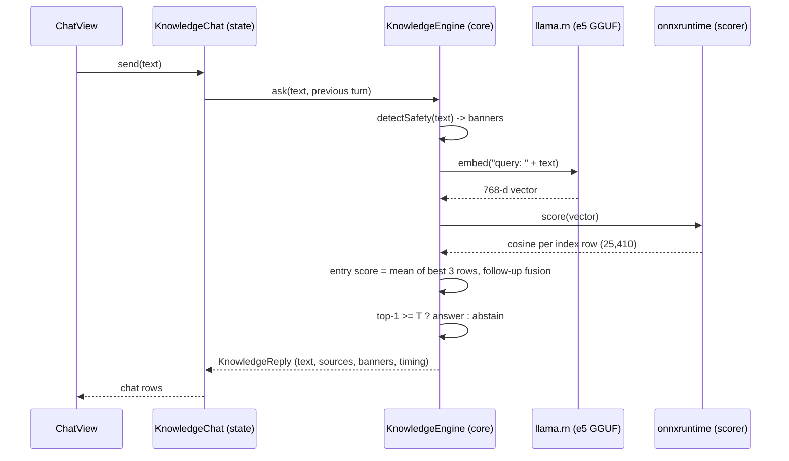

# Architecture

Current design of the knowledge system and the app around it. Superseded plans live in [`history/`](history/); `history/phase3-architecture.md` is the original design this one grew from (code comments still cite its sections).

## Guarantees

- The app never writes an answer. Every reply is a curated catalog answer (the entry's fidelity-reviewed natural reply) or a fixed policy text. There is no generative model on the phone.
- Safety first: text rules run before any model. An urgent message gets an urgency banner and the curated emergency entries; every reply carries the 123 national emergency line.
- No network: models and vectors live on the phone; nothing is fetched at runtime.

## Runtime pipeline

The retrieval core (vector gateway, the 15 gates, per-gate strategies, shared embedder, decision layer) is documented in depth in [`retrieval-architecture.md`](retrieval-architecture.md). This section is the call sequence.



| Step | Code |
|---|---|
| Safety rules (urgent, live status) | `mobile/src/core/knowledge/safety.ts` |
| Text cleaning (port of `experiments/nlu/kb.py` `clean`; off while `strip_fillers` is false) | `mobile/src/core/knowledge/clean.ts` |
| Retrieval and follow-up fusion | `mobile/src/core/knowledge/retrieve.ts`, `engine.ts` |
| Top-1 policy, banners, abstain | `mobile/src/core/knowledge/policy.ts` |
| Reranker seam (Laya, off) | `mobile/src/core/knowledge/rerank.ts`, `mobile/src/llm/laya.ts` |
| Native loaders | `mobile/src/llm/embedder.ts` (llama.rn), `scorer.ts` + `ort.ts` (onnxruntime), `knowledgeRuntime.ts` |
| Chat state | `mobile/src/state/knowledgeChat.ts`, `useKnowledge.ts`, `knowledgeRows.ts` |

The core (`src/core/knowledge`) is pure TypeScript with the embedder and scorer injected, so Jest runs it on Node against parity fixtures exported from Python.

If the side-loaded files are missing or fail to load, `degradedKnowledgeEngine` keeps the safety rules working and every other question returns an error row.

## Assets

Bundled with the app (generated, never edit): `mobile/assets/data/knowledge/`

| File | Content |
|---|---|
| `catalog.json` | 843 entries: `short` (the reply shown), `steps`, `sources`, `section`, `last_verified` |
| `sections.json` | 15 sections |
| `policy.json` | `version` `e5-nlu-v1`, threshold `T` 0.5, `score_topk` 3, follow-up settings, emergency entry ids, abstain and offline texts, `laya.enabled` false |
| `index.json` | Manifest: embedder file, size and sha256, 768 dims, 25,410 rows, vectors and scorer files, corpus hash |

Side-loaded into the app's files dir (`models/knowledge/` on the laptop, `mobile/scripts/push-knowledge.sh`):

| File | Size | Notes |
|---|---|---|
| `e5-nlu-ft4-f16.gguf` | 563 MB | multilingual-e5-base fine-tuned on park queries (Colab, `experiments/nlu/colab_train.py`). Not reproducible from the repo alone |
| `index.f32.bin` | 78 MB | row vectors, float32 little endian |
| `index_scorer.onnx` | 78 MB | MatMul over the same vectors |
| `laya_final.gather_int8.onnx` + tokenizer | 699 MB | only with `--with-laya`; unused while `laya.enabled` is false |

The app checks each file's size against `index.json` before loading it (hashes are recorded but not checked on the phone).

## Regenerating the assets

`experiments/nlu/export_nlu.py` reads `data/knowledge/sections/`, `data/knowledge/app/` and `experiments/nlu/work/queries_raw.jsonl`, embeds every index row with the GGUF through llama.cpp's `llama-embedding`, and writes the bundled JSON, the vectors, the scorer and the Jest parity fixtures. It runs in the `experiments/laya` uv environment:

```bash
cd experiments/laya
uv run python ../nlu/export_nlu.py --gguf ../../models/knowledge/e5-nlu-ft4-f16.gguf \
    --T 0.5 --w 5.0 --max-words 5 --below 0.7 --cue
```

These flag values are the ones stored in the shipped `policy.json` (inferred from it; the original command line was not recorded). `--llama-embedding` defaults to `~/.cache/llama.cpp-src/src/build/bin/llama-embedding`.

Evaluation: `experiments/nlu/evaluate.py`, `gguf_eval.py`, `context_eval.py` on the blind sets in `experiments/nlu/work/` and `data/knowledge/eval_v2/` (sealed splits).

## Onboarding and rendering

| Platform | Scene and Pet renderer |
|---|---|
| Android/iOS | `@shopify/react-native-skia`: `src/onboarding/SceneCanvas.native.tsx` + `skia/drawScene.ts`, `src/ui/pet/PetVaporCanvas.native.tsx` + `drawPet.ts` |
| Web (Lab, design catalog, previews) | `react-native-svg`: `src/onboarding/NevadoScene.tsx`, `src/ui/pet/PetVaporFigure.tsx` |

Both renderers draw the same `SceneDoc` (`src/onboarding/scene/`). The SVG renderer is the reference: a new body kind must be added to both. Native moved to Skia because react-native-svg on Android redraws every changed layer into a CPU bitmap; on the reference phone that meant ~230 ms frames, against ~10 ms with Skia.

## Legacy

Before 2026-11-22 the app ran a small LLM (Gemma, then a Qwen3 router) driving a finite-state machine. That stack is gone from the chat. What remains:

- `mobile/src/core/{driver,guards,prompts,parse,states,tools,values,world}.ts`, `mobile/src/llm/{llamaRn,modelManager,models}.ts` and `app/settings.tsx`: the settings screen still lists models and loads `assets/data/world.json`.
- `src/nevados_bench/` (`export_mobile.py` and what it imports) regenerates `world.json` and the legacy parity fixtures.

Removing them means removing the settings screen controls first. The benchmark reports and plans of that period are in `docs/history/`.
