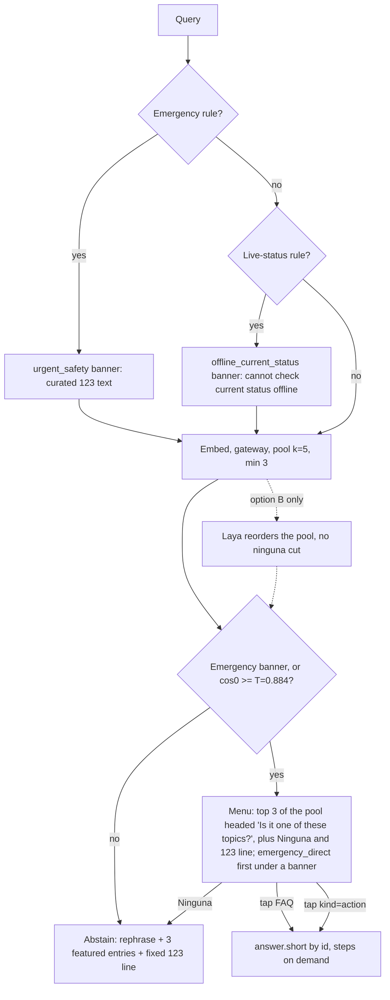

# Phase 3: final knowledge-system architecture

## 0. Status and evidence legend

Proposed 2026-11-22 for the 2026-11-26 hackathon; not yet approved. Where this file and the Phase 3 section of [plan-knowledge-system.md](plan-knowledge-system.md)
disagree, this file wins (see §6).

Inputs: the retrained Laya run `run_rlcd6` (model sha `f3644502…`, under `models/laya_final_rlcd6_raw/`), policy v2 (`faq-top3-v2`), and four review audits (metrics,
dataset, policy, knowledge bundle; paths in the Appendix).

Tags: [V] I ran it for this document (Appendix); [A] from an audit that ran it; [C] cited from a repo or bundle file; [I] inference; [E] estimate, not measured.

## 1. Decision: what ships for the demo

**Ship an e5-only top-3 menu, with safety text rules running before any model. Keep Laya out of the demo build, as an add-on behind the gate in §1.4. Never auto-answer.**

Why:

1. **The product never auto-answers, so menu quality is what counts, not top-1 accuracy.** Policies v1 and v2 have `direct_n = 0`. No direct-answer rule reaches a Wilson
   upper bound of 3 % wrong. The best one answers 12 calibration rows (upper bound 24.3 %), then gets 2/19 wrong on the sealed set [A metrics §3].
2. **At menu level there is no evidence either way** [V, my analysis, not an audit]. The decision rests on cost (RAM, dependency, port), not on accuracy. Success: an
   in-scope query gets a menu that contains a valid FAQ; an out-of-scope query gets no menu. Pooled held-out = unseen + adversarial + sealed + retrospective (1,362 rows).
   The e5 menu uses T = 0.884, fitted on calibration only.
   - policy v2 as frozen: **926 vs 926** (123 vs 123 discordant, p = 1.0); sealed 204 vs 207;
   - Laya order plus its own `ninguna` cut fitted on calibration: 854-885 vs 926 (p ≤ 0.021), even though it wins in-sample on calibration (204-207 vs 192);
   - Laya only reordering the e5 menu, with e5 abstention: 936 vs 926 (p = 0.13). Sealed top-3 recall (224 answerable rows) is also equal: 97.3 % vs 97.8 % [A metrics
     §4].
3. **Where Laya does differ:**
   - correct option at #1: 624-626 vs 596 pooled (p ≈ 0.09) [V];
   - adversarial split: 151 vs 136 (p = 0.04) [V];
   - out-of-scope rejection on retrospective: 77 vs 92, in e5's favour [V]. Its own abstention says "ninguna" on 21 % of answerable sealed rows [A metrics §1].
4. **The +7.1-point top-1 headline (64.3 % vs 57.1 %) is against an e5 that can never abstain.** Against e5 with a cosine threshold fitted on calibration, the gain is
   +4.1 points [−3.1, +11.3], and all of it comes from rejecting queries [A metrics §2].
5. **Laya adds at least 0.7 GB of unmeasured RAM** to a budget already past the ~1.5 GB free-at-idle figure (§1.3). It also needs a new native dependency and a TypeScript
   port of its 52 KB input/output layer (`laya/onnx_agent.py`) plus a 34 MB tokenizer [V].

Limits of my menu comparison:

- T is not identified by calibration. Calibration success is flat over T in [0.870, 0.894] (186-192 rows, argmax 192 at 0.884, one row above its neighbours). Pooled e5
  success is 946 at 0.88, 926 at 0.884 and 902 at 0.89, so the e5-vs-v2 verdict flips sign (+20 / -24) inside calibration noise. "926 vs 926" is partly a coincidence of
  T. 10.9 % of pooled rows (148/1,362) have cos0 within +-0.005 of T, and a systematic embedder shift of -0.005 / +0.005 moves pooled success to 905 / 949 [V, `c1.out`,
  `c2.out`]. Option A's phone accuracy is +-1.5-2 points depending on the embedder.
- Both arms reuse v2's notice-only decisions (same text rules). The banner-plus-menu design in §2 was not simulated.
- "Success" means a valid FAQ is in the menu, not that the user picks it.
- The sealed set has already been inspected [C policy_v2/README.md, limitation 2].

### 1.1 Options

| Option | Menu success, sealed | Pooled held-out | Extra on the phone | Verdict |
|---|---|---|---|---|
| A. e5-only menu | 207/294 (70.4 %) | 926/1,362 | e5 GGUF only | **Ship** |
| B. e5 + Laya menu (policy v2) | 204/294 (69.4 %) | 926/1,362 | +699 MB ONNX, onnxruntime-react-native | Gated add-on |
| C. B + guarded direct answer | not a menu metric; see note | — | same as B | Rejected |

Note on C: the best direct rule had 5 % coverage, 6.8 % wrong, Wilson upper 14.9 %, measured on 5 held-out splits (74/1,483 rows), not on sealed [A policy §4].

### 1.2 Emergencies: banner plus menu, not a direct answer

`answer_policy.json` marks 40 FAQs `emergency_direct`. Measured on all six splits (1,775 rows) [V]:

- e5 option #1 is one of those 40 on 132 rows, but it is acceptable on only 76 of them (57.6 %). So "answer directly when the top-1 is an emergency FAQ" is wrong about 4
  times in 10. The v2 README says v1 dropped this trigger for false alarms [C].
- When the urgent text rule fires (15 rows), an acceptable emergency FAQ is in the pool on 13, and in an `emergency_direct`-first menu of max 3 on 12/15 (80 %, Wilson
  [54.8, 93.0]); plain top-3 gives 11/15 [V, `c2.out`].
- The text rule fires on only 7/38 `kind=emergency` rows (18.4 %, Wilson [9.2, 33.4]). Under the e5 menu at T = 0.884 those 38 rows give 7 notice, 23 menu with a valid
  FAQ, 5 menu without one and **3 abstain** (7.9 %): all just under T (cos0 0.868-0.882: storm, shock, scald) [V, `c1.out`]. So a missed emergency can reach the abstain
  screen.
- 8 of the 40 `emergency_direct` ids are `actions.report_*` entries with `action = report_emergency` [V, `c3.out`]. Their hand-off is a blocker, see §1.2a.

Design: show the fixed banner on top of a menu. Its text is rendered from the curated entry `health_safety.national_emergency_number_123` (`answer.short` plus its source;
16 curated answers contain "123" [V]), not hard-coded. That menu lists the pool's `emergency_direct` FAQs first and skips the abstention threshold. It costs one tap, and
the safety text never depends on a model.

Rule-independent 123 line (blocker B2): the regex is not a classifier, so every menu footer and the abstain screen also carry the same curated 123 line, and the chat
header has a persistent emergency button that opens the `health_safety` emergency entries. These are unfitted safety overrides, not accuracy claims.

### 1.2a Action entries never reach the FSM in the demo (blocker B1)

The FSM runs the fictional world (`mobile/assets/data/world.json`: stations `alto_cenizo`, `laguna_espejo`, `valle_bruma`, `refugio_quelital`). Its emergency passages
name a meeting point and radio channel 31 that do not exist in the real park, and `report_emergency` needs a fictional `station` and returns "Deterministic mock result"
passages [C `mobile/src/core/tools.ts:115-140`]. Handing a real visitor's injury report to it would state uncurated facts. Decision: tapping an `kind=action` entry shows
its curated `answer.short` only (it already says to call 123 and that the app does not alert rescue). No `DialogueRun` hand-off in the demo; a later form must echo only
the user's own input. The knowledge path never reads `world.json`. Consequence: the router r1 is not needed in the demo build, and is loaded lazily if it ever returns.

### 1.3 Model format and RAM budget

| Item | Format | Size on disk | RAM | Status |
|---|---|---|---|---|
| Router r1 (actions only; not in the demo build after §1.2a) | GGUF Q4_K_M, llama.rn | ~397 MB [C plan] | Base Qwen3-0.6B peaked at **1.27 GiB** on the phone. The app default today is `gemma4-e2b` [C mobile/src/state/settings.ts:15], which peaked at 3.71 GiB and still launched [C results/r2-phone/REPORT.md:50,52]. The report does not say what "peak" measures or at which n_ctx. The same row is `safety_critical_fabrication FAIL (13, n=133)` for Gemma, so that default must not ship | Measured once |
| e5-base query embedder | GGUF Q8_0 (or f16), second llama.rn context | ~0.3 GB Q8_0, ~0.56 GB f16 [E, 278 M params] | Unmeasured | Not built |
| Index vectors | fp16, 11,118 × 768 | 17.1 MB [V] | 34.2 MB as Float32Array [V] | Not built |
| Catalog, labels, policy | JSON | ~1.7 MB [C bundle file sizes] | ~same | Not built |
| Laya rlcd6 (option B only) | ONNX, int8 on Gather, fp32 layers | 698.8 MB [C results/p3-final/e11_onnx_parity.json] | Unmeasured; at least the file size if ORT loads it into heap [I] | Not in the build |
| Laya fp32 / full int8 | ONNX | 1,288 MB / ~334 MB (E10) [C phase1-laya-report.md:250,248] | — | Rejected: size / in E10 full int8 lost 4.3-4.7 points (Laya 63.3 vs 68.0, Laya+cos 65.0 vs 69.3) [C phase1-laya-report.md:248,250] |

Budget: the phone has ~1.5 GB free at idle [C docs/project-context.md:12]. That is not a hard ceiling, because Gemma E2B ran at a 3.71 GiB peak. The real limit for 2-3
resident models is unknown.

- **Option A:** 1.36 GB (Qwen router peak) + 0.3-0.6 GB (e5) ≈ 1.7-2.0 GB [E], or 4.3-4.6 GB with Gemma as the router. With §1.2a the router can stay unloaded, which
  removes most of this risk. Measure it in the day-1 spike (§4, fix 0). Levers if memory is tight:
  - The router's KV cache at n_ctx 4096 is about 470 MB at f16 [E: 28 layers × 8 KV heads × 128 × 2 × 2 B × 4096]. A q8_0 KV cache or n_ctx 3072 saves 120-235 MB. The
    route prefix is ~2k tokens [C mobile-offline-stack SKILL.md], so n_ctx 2048 is too small.
  - GGUF weights are mmap'd and file-backed, so Android can reclaim them [I].
- **Option B:** adds at least 0.7 GB: about 2.4-2.7 GB with the Qwen router, about 5 GB with Gemma. Unmeasured.
- E11, Gather-int8 on the laptop (4 threads, other agents running) [C e11_onnx_parity.json]: same choice as Colab on 97.62 % of sealed rows (7/294 differ),
  max-probability difference p95 0.079, p50 101.8 / p95 144.3 ms. Its accuracy was not recomputed.

### 1.4 Gate for Laya to come back

Laya returns only when all of the following hold:

1. **RAM:** 30 mixed FAQ and action turns with router + e5 + Laya resident, with no app kill or model reload, and the peak recorded with `adb shell dumpsys meminfo`.
2. **Latency:** Laya p95 ≤ 400 ms on the phone at k = 5. This is a new, stricter bar: Phase 1's was p50 ≤ 400 ms on the laptop CPU [C plan-knowledge-system.md:136].
3. **Accuracy:** as a reorderer under e5's abstention (its own `ninguna` cut lost on held-out data), a significant (p < 0.05) gain in menu success or correct-at-#1 on a
   **new** blind set of real typed queries, not on the inspected sealed set.
4. **Dependency and parity:** `onnxruntime-react-native` approved, plus a TypeScript port of the tokenizer, `_encode_state` and `_decode_answers`. Fixtures must show 0
   choice mismatches against Python on the 1,775 eval rows.
5. **Retrain:** a new checkpoint trained after the dataset fixes in §4 (post-demo list).

## 2. Runtime pipeline on the phone

`mobile/` has no knowledge, retrieval or embedding code yet: `src/core` holds the FSM port and `src/llm` holds the LLM backends. No file references `policy_engine_v2`,
and `package.json` has no `onnxruntime` [V grep; A policy §6]. Everything below is new code.

Decisions. A banner never replaces the menu, and a throw in e5 or the pool still shows the banner:



Who runs what, with the per-stage budget (the menu is "top 3 of the pool": the gap 0.085 was never fitted and is inert, pooled success is 926 for gap 0.05, 0.085, 0.12
and 1.0 [V `c1.out`]):

```mermaid
sequenceDiagram
  participant UI as Chat UI (app/, src/chat)
  participant K as src/core/knowledge (pure TS, new)
  participant E as src/llm/embedder.ts (llama.rn embedding context, new)
    UI->>K: ask(text)
  K->>K: safety + live-status rules (<1 ms)
  K->>E: embed("query: " + text) (<=80 ms)
  E-->>K: 768-d vector, L2-normalised
  K->>K: scores over 11,118 rows, gateway, pool (<=60 ms)
  K->>K: menu policy (<1 ms)
  K-->>UI: banner?, options[] or abstain
  UI->>K: tap(faq_id), checked against the menu shown
  K-->>UI: curated answer + sources (<5 ms)
  ```

| Stage | Runtime | Phone budget | Evidence |
|---|---|---|---|
| Safety and live-status rules | TS regex, `src/core/knowledge/safety.ts` (new) | < 1 ms | [I] |
| Query embedding | llama.rn `embedding()`, own `Embedder` context (`n_ctx 512, n_threads 2`), e5-base GGUF | ≤ 80 ms | The laptop measured 29.8 ms (sentence-transformers) [C phase1-laya-report.md:45]. llama.rn 0.12.9 exposes `embedding` and ships BERT-family archs [V grep]. Not verified: XLM-R GGUF conversion, mean pooling, cosine parity, phone speed |
| Scoring, gateway, pool | TS over Float32Array, port of `build_dataset.py` `Index.retrieve` | ≤ 60 ms (target, unverified) | 8.5 M multiply-adds per query [V arithmetic]. Hermes (RN 0.88.1) is likely an interpreter without JIT, so a plain JS loop may cost hundreds of ms [I]. Day-1 probe: time a dummy 8.5 M MAC loop in the dev build. Fallbacks: int8 vectors with `Int8Array`; a Kotlin native module (outside the whitelist, needs approval) |
| Menu policy | TS, `src/core/knowledge/policy.ts` (new) | < 1 ms | [I] |
| Answer lookup | TS map by id | < 5 ms | [I] |
| **FAQ turn total** | — | **p50 ≤ 150 ms, p95 ≤ 300 ms**; cold start (kill and relaunch, e5 init + warm-up + index load) ≤ N s, N set by the day-1 spike | Target [E] |
| Laya (option B only, reorder) | onnxruntime-react-native | p95 ≤ 400 ms | Laptop p50 101.8 / p95 144.3 ms [C e11] |
| Action turn | Curated `answer.short` | < 5 ms | [I] |

Load the e5 context once at startup and warm it with one dummy query; never per turn. It must NOT go
through `ModelManager`: that class holds one `ctx`, releases it before every load
(`mobile/src/llm/modelManager.ts:85`) and uses `n_ctx 4096, n_threads 4`. Two 4-thread contexts would
contend on the 4 big cores [I; `docs/project-context.md:10-12`].

## 3. Data contracts and build

The app must run the retrieval contract the data was built with:

- e5-base with the `"query: "` prefix on every text;
- index rows are the label plus the examples of visitor entries;
- gateway: up to 5 sections within 0.05 of the best. A section's score is the max cosine over its
  description and texts;
- each section contributes its `retrieval.top_k`, and the pool keeps the best 5 by entry score;
- fewer than 3 entries are filled from the flat ranking.

Reference: `scripts/build/build_dataset.py:1-16,113-142` in the dataset bundle [C].
`experiments/laya/retrieval.py` lacks the min-pool fill, so port the bundle version.

### 3.1 Files that ship

All of these are GENERATED into `mobile/assets/data/knowledge/`. Never edit them.

| File | Content | Built from |
|---|---|---|
| `catalog.json` | Per visitor entry: id, section, kind, label, clarification label, `answer.short`, `answer.steps`, sources, `last_verified` (shown as "revisado", reviewed; all 757 values are 2026-11-21/22, the curation pass, and 49 entries have none [V `c3.out`]), source date, `valid_until`, `action` | `data/knowledge/sections/*.json`, plus clarification labels |
| `sections.json` | id, order, title, `top_k`, `featured`, `clarification.fallback` | Same section files (the bundle copy lacks `featured` and `clarification` [A knowledge]) |
| `index.f32.bin` (or fp16 decoded once into the app files dir) | 11,118 rows × 768: one row per label or example, then 15 section-description rows; 34.2 MB fp32, 17.1 MB fp16 [V]. fp32 needs no per-element decode in JS (8.5 M values for fp16) [I]. Metro has no `bin` in `assetExts` (`mobile/metro.config.js` adds only `wasm`), so add it or side-load with the GGUF | e5-base **GGUF run through llama.cpp on the laptop**, the same weights the phone uses |
| `index.json` | Manifest: embedder id + GGUF file size and a sha256 computed on the laptop, prefix, dims, row → entry and row → section maps, per-section content hash, corpus hash | Exporter |
| `policy.json` | `e5-menu-v1`: T 0.884, gap 0.085, max 3 options, k 5, min pool 3, δ 0.05, ≤ 5 sections; the 40 `emergency_direct` ids; safety-rule version; `fitted_on` and corpus hash | `answer_policy.json` + fit script |

Rules:

- The app refuses to start the knowledge path if the GGUF name and size, or the corpus hash, differ
  from the manifest (no byte hashing on the device: no hashing API in the whitelist, and ~300 MB in
  Hermes JS would take seconds). The e5 GGUF is side-loaded like the other GGUFs
  (`scripts/push-model.sh`, not verified for the index). Changing the embedder means a full rebuild and a refit of T.
- Show `answer.short`: 0 entries exceed 600 characters. Full text (short + variants + steps + detail)
  exceeds 600 in 161 entries [A knowledge], so `steps` stay behind a "ver más".
- The menu shows **clarification labels**, not entry labels. They are not in the sections (0/806
  entries have one [V]); they come from the dataset finaliser (`finalize_knowledge.py`, X4 draft
  + H2 review) [C]. A new entry without one falls back to its `label`.

### 3.2 Build chain

```mermaid
flowchart LR REG[add-park-knowledge registry] --> CO[coordinator rebuild_all] CO --> SEC[data/knowledge/sections/*.json, generated, never hand-edit] SEC --> VAL[kb.py
validate] VAL --> EXP[export_knowledge.py, new, src/nevados_bench] LAB[clarification_labels.json] --> EXP APOL[answer_policy.json] --> EXP GG[e5-base GGUF + llama.cpp]
--> EXP EXP --> OUT[mobile/assets/data/knowledge/*] EXP --> FIX[src/core/__fixtures__/knowledge_pools.json: 1,775 eval queries to pool ids]
```

The bundle's `faq_catalog.json` matches today's working tree, but not HEAD (26 answers differ), and
another agent is still editing the sections [A knowledge]. The exporter therefore reads the repo
sections at freeze time and never the bundle. Freeze time: set before fix 4 starts and recorded in
`index.json` with the corpus hash.

### 3.3 Adding or changing a topic

1. Add it through the `add-park-knowledge` skill, then run `rebuild_all` and `kb.py validate`.
2. Run the exporter. It re-embeds all 11,118 texts and rewrites the manifest. Re-embedding
   everything is simpler than per-section files, and its cost is not measured and needs a llama.cpp embedding binary on the laptop [E: minutes].
   Script `rebuild + refit T` as one command.
3. **e5-only (option A): no retraining.** The new entry can be retrieved at once. On the held-out
   unseen-topics split the e5 menu does as well as v2: 167/229 vs 164/229 [V]. Caveat: 193/229 of those
   rows are held-out corpus examples (none has cos0 >= 0.999, max 0.990), so this speaks to Laya's
   training catalog, not to retrieval of truly new topics [V].
4. Always refit T on the GGUF vectors at freeze (cheap), using the calibration plateau centre or a
   bootstrap median rather than the single argmax. For later changes this needs the calibration pools
   rebuilt with `build_dataset.py` against the new corpus and GGUF vectors.
   Adding examples to fix misses: only new, independently written phrasings. Re-run the semantic
   leak check (e5 cos >= 0.93) against all eval splits afterwards, and record the corpus hash with
   each eval number; the exact + trigram `check_leakage.py` misses paraphrases [A dataset §1].
5. **With Laya (option B):** Laya reads entry labels as its options. On unseen topics it is worse
   than e5 on answerable rows (63.6 % vs 74.5 %) and its pure reranking is −1.6 points
   [A metrics §1]. So:
   - if any pool id is outside Laya's training catalog, skip Laya for that query and keep e5 order;
   - retrain before routing new topics or relabelled entries through it.

## 4. Fixes that must land before the demo

Order matters: fix 0 gates fixes 4-5. Owners marked "(new)" do not exist yet. Line numbers point to
the read-only bundle copies, `policy_v2/policy_engine_v2.{py,js}`.

| # | Fix | Owner file | Acceptance | Time |
|---|---|---|---|---|
| 0 | Day-1 spike: convert e5-base with `convert_hf_to_gguf.py`, load it in a throwaway screen with `embedding: true`, embed 20 queries and compare with sentence-transformers; time a dummy 8.5 M MAC loop in Hermes; read `dumpsys meminfo` with the e5 context resident (and the router if kept). llama.rn ships `LLM_ARCH_BERT` and the UGM vocab [C `llama-arch.cpp:22`, `llama.h:77`], so conversion is plausible, not proven | throwaway screen in `mobile/` | Cosines match; scoring cost known; RAM known; cold start measured. Fallback if conversion fails: e5-small plus a full index rebuild and T refit | 1.25 h |
| 1 | B1 + B2: no FSM hand-off for action entries (§1.2a); curated 123 line in every menu footer and abstain screen; emergency header button; default model off `gemma4-e2b` (13 safety-critical fabrications, n=133) | `mobile/src/state/settings.ts`, chat UI | An action tap shows `answer.short` only and never reads `world.json`; abstain screen shows the 123 line | 1.5 h |
| 2 | Run the safety and live-status rules **first**, before e5. Return a banner **plus** the menu instead of the notice-only `options: []`. Emergency_direct first under the banner. The live-status rule covers "sta", "habilitada" and does NOT require a time anchor (a false positive costs only a banner; the sealed row "la caretera manizales bogota... sta habilitada" has none). Origin: py:88-95, js:47-49, py:39, js:20 | `mobile/src/core/knowledge/safety.ts`, `policy.ts` (new) | A model or pool error still shows the banner. "¿el parque está abierto los lunes?" gets the hours menu. Today a valid FAQ is in the hidden top-3 in 12/15 urgent and 8/16 offline cases [A policy §1] | 2 h |
| 3 | Rewrite the emergency patterns: first-person and present-tense stems for lost, hypothermia, altitude, ash, injury and lightning. Drop bare "urgente"/"emergencia". Apply the "qué hago si" exclusion only to weak patterns, never to "no respira", "inconsciente" or "desangrando". Origin: py:28-35,48, js:11-18,26 | `safety.ts` + `src/core/__tests__/safety.test.ts` (new) | Measured on a **frozen unbiased set**: 30-40 emergency and 15 informative phrasings written by someone who has not seen the patterns, before the rewrite. Report recall with a Wilson interval (30/38 means [64, 89] %). The inspected 38 rows and the 25-query probe set (written after the regexes) are regression checks only (today 7/38, 5/25; false positives 5/15) [A policy §3] | 3 h incl. a second person |
| 4 | Knowledge exporter plus the TS retrieval port, with parity fixtures **generated with `mask_text` applied**, as the stored pools were (`build_dataset.py:13-15`) | `src/nevados_bench/export_knowledge.py` (new), `mobile/src/core/knowledge/retrieve.ts` (new) | Masked pool ids identical to `build_dataset.py` on all 1,775 eval queries given the same vectors (unmasked, ~193 corpus-example rows score cos 1.0; check unmasked behaviour separately). Validator OK at freeze | 4 h |
| 5 | e5-base GGUF plus the separate `Embedder` (own `initLlama`, not ModelManager); index built with the same GGUF; T refit on GGUF vectors | `mobile/src/llm/embedder.ts` (new), `models.ts` | Versus sentence-transformers fp32 on the 1,775 queries: \|mean Δcos\| ≤ 0.001 (signed bias; p99 ≤ 0.005 alone allows a bias that moves pooled success by ~20 rows) and abstain/menu flips ≤ 1 % of rows | 2.5 h |
| 6 | Chat UI: banner, menu, answer, "ver más", abstain, "Ninguna"; APK build and install (`mobile/app/index.tsx` is already modified in the worktree) | `mobile/app/`, `src/chat` | Runs on the Moto Edge 60 Fusion | 5-6 h [E] |
| 7 | Measure on the phone | `results/p3-phone/` (new) | 30 mixed turns, no kill or reload, peak (`dumpsys meminfo`); FAQ p50/p95; cold start after kill and relaunch; 50 real typed queries from someone who has not seen the dataset | 2 h |

Total about 20-22 h [E], not 12.5 h: the earlier figure left out fix 0, the UI, the second context,
the T refit, the asset path and the APK. It leaves little slack; a failed GGUF conversion in fix 0
triggers the e5-small fallback. If fix 7 fails on RAM, apply the router KV levers before shrinking
e5 (e5-small embeds in 7.3 ms on the laptop [C phase1:45]).

### 4.1 Only if Laya ships (option B), or after the demo

| # | Fix | Owner | Time |
|---|---|---|---|
| 8 | Harden the JS engine: `Number.isFinite` checks on probabilities, cosines and alpha; required `alpha` and `menu.max_options` (a missing value gives 5 options today); unique criteria and pool ids | `policy_engine_v2.js:32-40,47,58` port | 1 h |
| 9 | Fix the abstention rule. `min_e5_with_high_none = 0.91` makes it in effect "none ≥ 0.45": 27 sealed in-scope abstentions had a valid FAQ in the top-3. Refit on calibration only | `policy.json`, engine py:105-107 / js:54 | 1 h |
| 10 | Dataset relabel and retrain: re-judge about 1,000 `retrieval_miss` rows that have a curated hard negative or high-cosine candidate; judge pool-vs-gold on the 478 flagged positives; add multi-positive and clarify rows (train has 0); ablate without `retrieval_miss` rows [A dataset §5] | `research_notes/dataset_final/tools/build_dataset.py` | 1-2 days |
| 11 | Build a new blind eval set of real typed queries (the sealed set is no longer blind) | `data/knowledge/eval/` | 0.5 day |
| 12 | Correct the v2 README: it names `policy_v2.json`, `tests/`, `scripts/` and `source_data/`, which do not exist | bundle `policy_v2/README.md` | 10 min |

Verified from the run config: `run_rlcd6` shuffled the choice options (`shuffle_options: ["choice"]`
in `model/rl_agent_config.json` [V]). This answers the dataset audit's open question.

## 5. Risks and what is not measured

| # | Risk | Evidence | Mitigation |
|---|---|---|---|
| 1 | Out of memory, or Android killing the app | ~1.5 GB free at idle; Qwen router peak 1.27 GiB, Gemma 3.71 GiB; e5 adds 0.3-0.6 GB; no multi-model run measured [C; E] | Fix 0 spike first; router unloaded after §1.2a; separate e5 context (`n_threads 2`); KV levers; e5 Q8_0 |
| 2 | Embedder drift moves the threshold | Pooled success is 946, 926, 902 and 825 at T = 0.88, 0.884, 0.89 and 0.90 [V] | Build the index with the phone's GGUF; signed-bias parity gate in fix 5; always refit T at the plateau centre; T is not identified by calibration (§1) |
| 3 | Lexical safety rules miss emergencies | 7/38 detected today [A policy §3]; 3/38 emergency rows abstain under the e5 menu [V]. Even after the rewrite they are not a certified classifier | Rule-independent 123 line on every menu and the abstain screen, plus an emergency button (§1.2); banner text from the curated entry; no FSM hand-off (§1.2a) |
| 4 | Real queries differ from the eval | `final_test` is 294/294 synthetic and train is 97 % corpus examples [A dataset §5]. Retrospective is harsher [A metrics §5] | 50 real typed queries in fix 7; demo script uses rehearsed phrasings. Menus are headed "Is it one of these topics?" with "Ninguna" visible: 46.5 % of out-of-scope pooled queries (128/275, Wilson [40.7, 52.4]) get an e5 menu [V] |
| 5 | Retrieval misses, not ranking, are the main loss | 26 of 27 sealed **v2 (Laya)** menu misses have the gold FAQ outside the pool [A policy §4]; not recounted for the e5 menu | Add only new, independently written examples (skill), then re-run the semantic leak check (§3.3). Never copy sealed or retrospective queries into the index |

Not measured, so none of these may be claimed in the demo:

1. Phone RAM for any setup with two model contexts. Phone latency of e5, scoring and Laya. Hermes JIT status and the JS scoring cost. Cold start and fp16 decode.
2. XLM-R GGUF conversion and mean pooling in llama.rn 0.12.9, and cosine parity with the index.
3. Hermes support for `normalize('NFKD')`, `toLocaleLowerCase('es')` and `Array.prototype.at`,
   which the v2 JS engine uses [A policy §6]. The new TS must not depend on them untested.
4. The accuracy of the Laya Gather-int8 ONNX itself (only the 97.6 % choice agreement), the
   semantic leakage check [A dataset §1], and any comparison with E10 (different data and eval).
5. Whether visitors pick the right option from a menu. Every success number here assumes they do.

## 6. Deltas from the plan and open decisions

| Plan said | Now | Why |
|---|---|---|
| Pool of up to 8 candidates | k = 5, min pool 3 with flat fill | `build_dataset.py:44` [C] |
| Retrieval profiles (`lookup` … `chat`), BM25 weights, entity filters | Dense only for every section; profiles stay as metadata | Pools, thresholds and Laya were all fitted on dense pools. BM25 would shift the pool distribution and needs a refit |
| Confident → answer; two sections → combined answer; unsure → question from the bank | Always a menu of up to 3 clarification labels plus "Ninguna"; the banks are unused | No certifiable direct-answer zone (§1) |
| Laya int8 at ~330 MB | 699 MB Gather-int8, and not in the demo build | Full int8 loses the gain; RAM (§1.3) |
| One index file per section | One index file (fp32 or fp16) plus a manifest with per-section hashes | 34.2 / 17.1 MB in total |
| `safety` profile with a low threshold | Text rules before any model; emergency menus never abstain; a fixed 123 line everywhere, since the rules miss emergencies | Policy audit; critique B2 |

Decisions taken by the user on 2026-11-22 (they replace the open questions above):

1. **Demo world: the real PNN Los Nevados.** The fictional 4-station FSM, `world.json` and the router are out of the demo build.
2. **`onnxruntime-react-native` is approved** as a production dependency. It goes into the same dev-client build as the e5 spike, so switching Laya on later needs no native rebuild.
3. **No generative model and no router.** The app runs only this knowledge architecture: e5 query embedder (GGUF on llama.rn, its own context) plus the optional Laya reorderer (ONNX). `gemma4-e2b` and every SLM GGUF were deleted from the laptop.
4. **Option A (e5-only menu) is approved for the demo,** with Laya kept ready behind the §1.4 gate. Implementation plan: [phase3-implementation-plan.md](phase3-implementation-plan.md).
5. **Later the same day: top-1 only, in the main chat, Laya disabled.** It replaces the menu of decision 4. The engine answers with the best entry when its e5 cosine clears T, and abstains otherwise. An urgent query answers with the best emergency entry in the pool (no threshold), or with the 123 entry when the pool has none. Replies render as plain bubbles in `app/index.tsx` through `src/state/knowledgeRows.ts`. Measured cost on the 292 calibration rows: success 56.8 % (menu of 3: 66.4 %), T refit to 0.887. Of the questions answered, 41.6 % get a curated answer on the wrong topic. Laya stays wired and disabled (`policy.laya.enabled = false`; the runtime passes no reranker).

## Appendix: how the new numbers were produced

[V] numbers come from scripts run with `python3 -I` from `/tmp`, reading the eval rows and the
policy-v2 decisions. The policy audit's harness joined them in
`results/p3-final/review/parity/`.
Scripts and outputs are in `results/p3-final/phase3/` and `results/p3-final/critique/` (`c1-c3.out`,
`wilson.out`). Copied from the session scratchpad on 2026-11-22.

- `menu_cmp.py`, `menu_sens.py`, `laya_menu.py`, `emerg_top1.py` (outputs `*.out`): calibration-only T fit (grid 0.800-0.950), per-split and pooled menu success, McNemar tests, T sensitivity, Laya-ordered menus, `emergency_direct` at rank 1.
- Index size: label + examples of the 806 visitor entries = 11,103 rows, + 15 descriptions. Mermaid was not rendered (`mmdc` is not installed).
- Audits: `results/p3-final/review/metrics.md`, `dataset.md`, `policy.md`, `knowledge.md`.

## Rejected review items

- Critique M2 "load the router lazily": adopted only as a consequence of B1 (§1.2a), not as a separate mechanism.
- Critique B2 optional rule "skip abstention when an `emergency_direct` id is in the pool and cos0 >= T - 0.02": rejected; unfitted and not simulated, the fixed 123 line covers the risk.
- Critique §5 "cut Option B entirely": already deferred behind the §1.4 gate; the gate stays so Laya is not lost.
- Critique m6 recount of v2 misses for the e5 menu: not done (no new run); the figure is labelled v2 instead.

