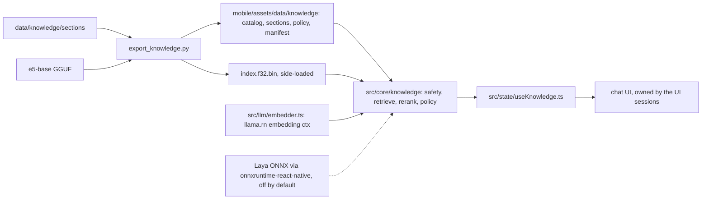

# Phase 3 implementation plan (approved design: e5-only menu, Laya-ready)

Design and evidence: [phase3-architecture.md](phase3-architecture.md). User decisions of 2026-11-22: real park, no generative model or router, `onnxruntime-react-native` approved, Laya kept ready.

## Scope

In scope:

- e5 query embedder on the phone;
- knowledge exporter;
- TypeScript retrieval, safety and menu policy;
- a reranker seam with Laya wired behind it;
- a hook the chat UI consumes;
- a device spike and measurements.

Non-goals:

- any generative model;
- the FSM or `world.json` in the demo path;
- Laya turned on by default;
- deleting the old LLM code. That is a separate change, done after the demo build works.

## Components

## Units, in order

| # | Unit | Owner files (new unless marked) | Acceptance | Needs phone |
|---|---|---|---|---|
| 1 | e5 GGUF parity on the laptop: convert, embed eval queries with llama.cpp, compare with sentence-transformers | `experiments/laya/gguf_parity.py`, `results/p3-final/` | \|mean Δcos\| ≤ 0.001, menu or abstain flips ≤ 1 % | no |
| 2 | Knowledge exporter with corpus hash, T refit on GGUF vectors, masked pool fixtures | `src/nevados_bench/export_knowledge.py` | Pools equal the dataset bundle's `build_dataset.py` on the eval rows; validator OK | no |
| 3 | TS core: safety rules first, retrieval port, identity reranker, menu policy, curated 123 line | `mobile/src/core/knowledge/*` | Jest parity on fixtures; the blind emergency set reported with a Wilson interval | no |
| 4 | Embedder context (separate from `ModelManager`) and the `useKnowledge` hook | `mobile/src/llm/embedder.ts`, `mobile/src/state/useKnowledge.ts` | Typecheck and lint; fake-embedder tests | no |
| 5 | Laya seam: `LayaReranker` on onnxruntime-react-native, Python I/O fixtures as the spec | `mobile/src/core/knowledge/laya/*`, `experiments/laya/laya_fixtures.py` | Fixtures written; the reranker is skipped when an id is outside its catalog | no |
| 6 | Dev-client build including onnxruntime-react-native, plus a spike screen | `mobile/package.json` (shared), `mobile/app/spike.tsx` | APK installs; e5 cosine parity on the phone; Laya session opens; `dumpsys meminfo` recorded | **yes** |
| 7 | Measure: 30 turns, p50/p95, cold start, 50 real typed queries | `results/p3-phone/` | Numbers on file | **yes** |

## Laya "ready": what is done now and what is left

- **Done now:**
  - the seam;
  - the native dependency, inside the same build;
  - asset side-loading;
  - Python fixtures with input tensors and logits;
  - a manifest flag `laya.enabled`.
- **Left to switch it on** (about 4-6 h, after the demo):
  - a TypeScript port of the Gemma-style BPE tokenizer and of `onnx_agent` encode/decode, made to pass the fixtures;
  - the §1.4 gate measured on the phone.

## Coordination

- Two UI sessions own `app/index.tsx`, `src/chat/*` and `metro.config.js`. This plan writes only new files, plus `package.json` and its lock for the native dependency.
- The UI consumes the `KnowledgeReply` type from `src/core/knowledge/types.ts`.
- `data/knowledge/sections` is still being edited. The exporter records a corpus hash, and the app refuses a manifest whose hash does not match its assets.

## Rollback

- Every unit is new files behind the new hook. Reverting means deleting `src/core/knowledge`, the embedder, the hook and `spike.tsx`, and running `npm uninstall onnxruntime-react-native`.
- The old LLM path stays untouched until a separate cleanup.
