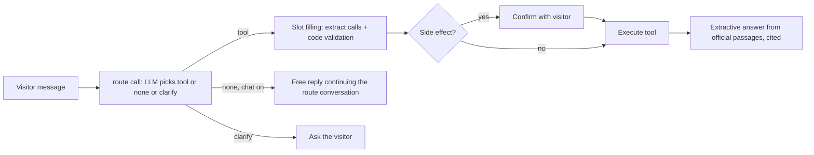

# Project context

State as of 2026-11-21. Hackathon: 2026-11-26.

## Goal

A 100 % offline assistant for visitors (tourists) of a high-mountain national park, running on a
phone in airplane mode. Latency is the first priority, then correctness: the assistant must never
invent hours, prices, phone numbers or figures.

Target device: Motorola Edge 60 Fusion, MediaTek Dimensity 7300 (MT6878), Android 16.
cpu4-7 are 2.5 GHz Cortex-A78, cpu0-3 Cortex-A55. Only ~1.5 GB RAM free at idle.

## Two knowledge worlds (open decision)

| World | Where | Content |
|---|---|---|
| Fictional park, 4 stations | `src/nevados_bench/world/` (exported to `mobile/`) | Alto Cenizo, Laguna Espejo, Valle Bruma, Refugio Quelital; trails, fees, hours, weather, rules, emergencies; 24 tools (2 with side effects: `register_visit`, `report_emergency`) |
| Real PNN Los Nevados | `~/Downloads/conocimiento.json` (user-provided, 44 intents) | Access from Manizales/Murillo, Brisas, Nevado del Ruiz, Armero 1985, páramo, fauna, rules |

The benchmark and the app use the fictional world. The new knowledge system (see
[plan-knowledge-system.md](plan-knowledge-system.md)) is being built on the real-park file.
Which one the demo shows must be decided before Phase 3.

## Repository map

| Path | Role |
|---|---|
| `src/nevados_bench/` | Python benchmark harness: world, FSM driver, guards, suites, runner (docker or phone over adb), scoring, reports |
| `data/suites/` | Benchmark suites: `fc_core`, `fc_ctx_sweep`, `fc_tools_sweep`, `grounded_qa`, `dialogues`, `smoke` |
| `data/finetune/` | LoRA router dataset (`train.jsonl` 7,055 examples, `dev.jsonl`, `nevados_ft.zip` for Colab) |
| `notebooks/finetune_router.ipynb` | Colab notebook used to train router r1 |
| `config/models.yaml`, `config/models.lock.yaml` | Model catalog and pinned GGUF hashes |
| `models/` (git-ignored) | GGUF files, `adapters/r1/`, ARM64 llama.cpp build `android-arm64-b12375/` |
| `results/` (git-ignored) | Run outputs: `r1`, `r2-*`, `r3-*`, `r4-router-r1` |
| `reports/r1`, `reports/r2` | LaTeX/PDF reports |
| `mobile/` | Expo SDK 58 dev-build app, llama.rn 0.12.9, TypeScript port of the FSM |

## Architecture of the current app

- FSM states: ROUTER, topic states, SLOT_FILLING, CONFIRM.
- Code guards: required args must be stated by the user; side-effect tools always confirm;
  passages filtered by station.
- Extractive answers make no model call. Chat mode (default on) gives free replies when no tool applies.
- Token streaming: `LLMBackend.complete(req, signal, onText)`; the UI shows route/extract JSON drafts while busy.

## Benchmarks and decisions

| Run | Date | Question | Result |
|---|---|---|---|
| r1 | 2026-11-15 | Which of 25 GGUF models? (laptop, phone-tight profile) | **Gemma 4 E2B Q4_K_M**: fc_core route correct 75.4 %. Weaknesses fixed in code, not fine-tuning |
| r2 | 2026-11-18 | Is Gemma fast enough on the real phone? | No: turn p50 6.1 s / p95 12.8 s (SLO 5 / 10 s). Rule fixed beforehand → train a LoRA router on Qwen3-0.6B |
| r2 | 2026-11-18 | Qwen3-0.6B base on phone | Turn 2.8 / 5.8 s (meets SLO) but dialogue success 61 % vs Gemma 81 % |
| r4-router-r1 | 2026-11-20 | Fine-tuned router r1 (laptop) | fc_core route correct **72.9 %** [67.0, 78.1]; tool selection 93.1 %; parse 100 %; dialogues 86.1 % [71.3, 93.9] vs Gemma 91.7 %; route p50 4.0 s vs Gemma 4.9 s; peak memory 1.41 GB |

Phone measurements: Gemma prefill ~100 tok/s, decode ~8 tok/s, phone ≈ 0.75× the laptop profile.
Router r1 on the phone: registration turns 1.3-4.7 s with a warm cache.

### Router r1 fine-tune

- Base Qwen3-0.6B, LoRA r32 / alpha 64, 1 epoch, LR 2e-4, ~1 h 48 min on a Colab L4.
- Dev exact match: route 0.9633, extract 0.99.
- GGUF `models/qwen3-0.6b-router-r1-Q4_K_M.gguf`, 396,704,608 bytes, sha256
  `8835a01f9d95d17c479551b8956baab311895806ffe5143ca98b1c09f579601f`.
- Dominant errors: guesses a station (`alto_cenizo`) instead of asking which one; date off by one day.
- Fine-tuning teaches behaviour and format, not facts. Facts must come from retrieved text.

## Size on the phone

| Part | Router r1 | Gemma 4 E2B |
|---|---|---|
| Model GGUF (measured) | 397 MB | 3,107 MB |
| Debug APK (measured) | 172 MB | 172 MB |
| Release APK (estimate, not built) | ~50-70 MB | ~50-70 MB |

Models are not inside the APK. They are copied to the app's `files/` directory.

## Known problems

1. **Single KV sequence in llama.rn.** Any call with a different prompt prefix evicts the ~2k-token
   route prefix. The next route call re-reads it (~23 s on 0.6B, ~35 s on 1.7B).
   - Chat and generated answers now continue the route conversation, so they share the prefix.
   - Route ↔ extract switching still evicts it. Candidate fix: llama.rn `saveSession` /
     `loadSession` per prefix; not measured.
2. **Open questions are slow and literal with an SLM.** A question outside the tools either goes to
   a free reply (slow, may be generic) or abstains. This motivates the embedding + System 1 plan.
3. **Extraction gap.** "Mi amigo" is not extracted as `people_count: 1`.

## Run recipes

- **Metro:** `cd mobile && npx expo start --dev-client --port 8081 < /dev/null`, then
  `adb reverse tcp:8081 tcp:8081`. Do not start Metro with `CI=1`: it stops watching files.
- **Build:** `cd mobile/android && ./gradlew assembleDebug -PreactNativeArchitectures=arm64-v8a`
  (~10 min), using the user SDK `~/Android/Sdk`.
- **Models onto the phone:**
  `adb shell run-as co.nevados.assistant cp /data/local/tmp/nevados/<gguf> files/<gguf>`.
- **Benchmarks:** `uv run nevados-bench run <batch> --target phone`, or the docker target.
  Use `--port 8081` for laptop runs while a phone run holds 8080.
- **Logs:** in dev builds, `console.log` goes to the Metro output, not logcat.
