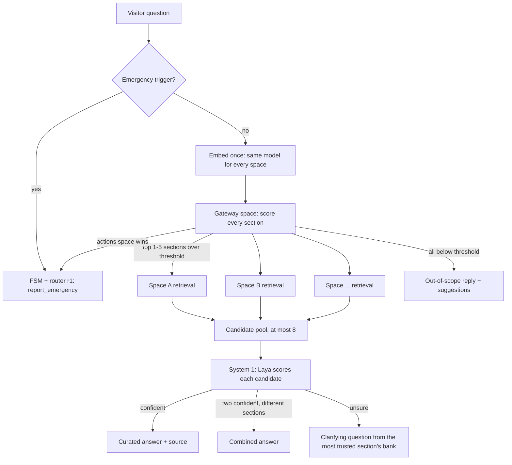
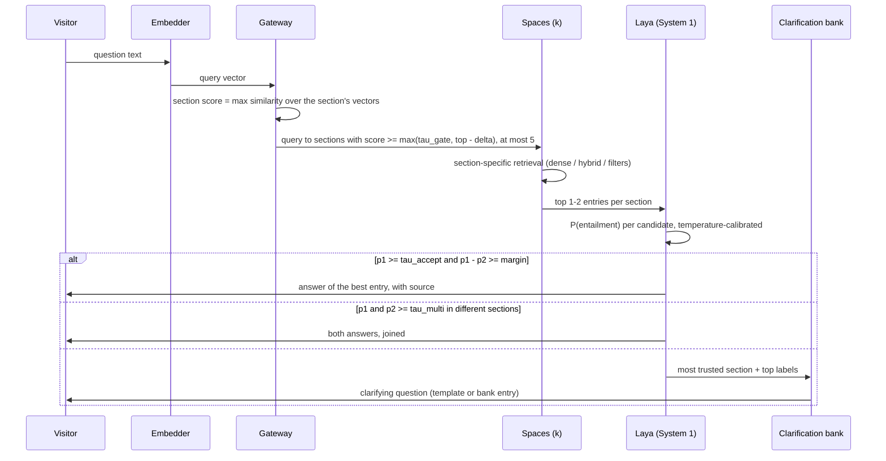

# Plan: embedding knowledge spaces + System 1 decision (Laya)

Status: Phase 1 done 2026-11-21. Laya zero-shot is no-go; see [phase1-laya-report.md](phase1-laya-report.md). Hackathon: 2026-11-26.

## Why

The SLM router answers open questions slowly and literally (1-4 s warm, ~23 s after a cache
eviction). Most visitor questions are FAQ-shaped. A retrieval system with curated, sourced
answers responds in well under 1 s and never invents data. A small non-generative decision model
(System 1) picks the best candidate and says when it is unsure. The SLM + FSM stays only for
actions (visit registration, emergency report).

Audience: tourists and visitors. Tone is a friendly park assistant. Internal regulations may be
included only when phrased for a visitor.

## High-level view

## Decision flow per question

## Phase 1: test Laya on the current knowledge base (Claude)

Input: `conocimiento.json`, 44 intents, 266 examples, 16 variants, 12 with step answers, about the
real PNN Los Nevados.

Goal: decide with numbers whether Laya earns its place as System 1, which embedding model to use,
and whether gateway routing beats a flat index.

### Phase 1 spaces (11, mapped from the 44 current intents)

| Space | Intents | Current labels |
|---|---|---|
| `access` | 7 | cómo llegar desde Manizales, cómo entrar en vehículo, acceso desde Murillo, dónde queda Valle de las Tumbas, los cuatro sectores, sector Santa Isabel, sector Nevado del Tolima |
| `booking_fees` | 5 | cómo reservar, cuánto cuesta la entrada, si necesitas guía, edad para ingresar, seguro de accidentes |
| `hours_status` | 3 | horarios de ingreso, si el parque está abierto, cierres por conservación |
| `activities` | 5 | qué se puede visitar, subir al cráter, acampar, fotografía, ver la cumbre |
| `preparation` | 1 | qué ropa y equipo llevar |
| `volcano_risk` | 1 | la actividad del volcán |
| `rules` | 2 | qué debes cuidar durante la visita, mascotas |
| `fauna` | 2 | aves, mamíferos |
| `flora_ecosystems` | 8 | ecosistemas, nieve y glaciares, Laguna del Otún, frailejones, agua, superpáramo, humedales altoandinos, páramo |
| `geography` | 7 | nevados del parque, qué es el Nevado del Ruiz, altura del Ruiz, nombre del cráter, departamentos, extensión y creación, parque vs volcán |
| `history_culture` | 3 | erupción de 1985 y Armero, qué es un lahar, nombre Kumanday |

### Steps

| # | Step | Output | Time |
|---|---|---|---|
| 1 | Copy the raw file to `data/knowledge/raw/conocimiento.v0.json`; convert it to the contract in [knowledge-contract.md](knowledge-contract.md); write the validator | `data/knowledge/sections/*.json`, validator command | 45 min |
| 2 | Build evaluation sets **before** running any model (see below) | `data/knowledge/eval/*.jsonl` | 45 min |
| 3 | Isolated environment `experiments/laya/` (own `pyproject.toml`, not a project dependency); download Laya PT/ES NLI and 2-3 embedding models | working `uv run` there | 20 min |
| 4 | Run experiments E1-E6 | `results/p1-laya/` | 60 min |
| 5 | Export the best Laya setup to ONNX int8; measure size, CPU latency and accuracy loss (E7) | `results/p1-laya/onnx.md` | 40 min |
| 6 | Write `results/p1-laya/REPORT.md` with the go/no-go verdict | report | 20 min |

Total ≈ 4 h of machine and authoring time.

### Evaluation sets (written before seeing model output)

| Set | Size | How |
|---|---|---|
| Leave-one-out | 266 | Each example is held out and used as a query against an index built without it |
| Fresh paraphrases | 88 (2 per intent) | New tourist-style phrasings, never in `examples` |
| Out of scope | 40 | Off-domain (restaurants in Manizales, weather in Bogotá, jokes) |
| Near miss | 20 | On-topic but not covered ("¿hay wifi?", "¿venden comida?") |
| Multi-intent | 15 | Two covered intents in one question |

The paraphrases are written by Claude. That bias is a known risk; Phase 2 adds independent ones.

### Experiments

| ID | Configuration | Question it answers |
|---|---|---|
| E1 | Flat kNN over all examples; models: EmbeddingGemma-300m, multilingual-e5-small, paraphrase-multilingual-MiniLM-L12-v2 | Which embedding model, and how good is "embeddings only"? |
| E2 | Gateway, hard top-1 section | How much does a wrong gate cost? |
| E3 | Gateway, soft top-k sections (threshold + delta, k ≤ 5) | Does multi-gate routing match or beat flat? |
| E4 | E3 + Laya, NLI form: premise = question, hypothesis = "El visitante pregunta sobre {label}." per candidate | Does Laya pick better than raw similarity? |
| E5 | E3 + Laya, one `choice` question over the candidate labels | Which Laya formulation works? |
| E6 | Best of E1-E5 + calibrated thresholds (accept, margin, multi, abstain) | Risk-coverage: how many answers at ≤ 3 % wrong? |
| E7 | ONNX int8 export of the E6 Laya | Size, CPU latency, accuracy loss |

Metrics: top-1 accuracy, recall@5 (gateway and final pool), MRR, out-of-scope rejection rate,
in-domain false rejection, risk-coverage curve, ECE, latency per stage (CPU, single thread and 4
threads), model size.

### Go / no-go for Laya (fixed now)

Keep Laya as System 1 if both hold:

1. On fresh paraphrases it either raises top-1 by ≥ 5 points over the best embedding-only setup,
   or, at ≤ 3 % wrong answers, answers ≥ 10 points more in-domain questions.
2. ONNX int8 scores 5 candidates in ≤ 400 ms p50 on the laptop CPU (4 threads). The phone is
   measured in Phase 3.

Otherwise: embeddings only with similarity and margin thresholds, and router r1 as the fallback
for ambiguous questions.

### Phase 1 risks

- The `laya` package or loader may not work as documented. The model card loads
  `frankyy03/laya-pt-es-nli`, which is not the repo ID. Fallback: load the encoder and head with
  `transformers` + `safetensors` directly.
- Laya PT/ES was trained on three-way NLI only. Spanish macro F1 is 0.79 (card). "Question is
  about X" is not classic NLI and may not transfer.
- 266 examples is small; thresholds may overfit. Report confidence intervals.
- EmbeddingGemma uses the Gemma terms of use, not Apache. Check them before shipping.

## Phase 2: expand the knowledge base ×20 (user, another platform, in parallel)

Target: about 900 entries and at least 9,000 examples, delivered as one file per section that
validates against [schemas/knowledge-section.schema.json](schemas/knowledge-section.schema.json).

| Space | Target entries | Notes |
|---|---|---|
| `access` | 80 | Every origin city, road, sector, entry point; public transport; parking |
| `booking_fees` | 70 | Fees by visitor type, payment, booking channels, requirements, insurance, guides, groups |
| `hours_status` | 40 | Hours by sector, seasonal closures, how to check status |
| `activities` | 90 | Trails, viewpoints, camping, photography, birding, what each sector offers |
| `preparation` | 60 | Clothing, gear, food and water, physical condition, what to bring for children |
| `weather_volcano` | 60 | Weather by season, volcanic activity levels, alerts, ash, what they mean for a visitor |
| `health_safety` | 70 | Altitude sickness, hypothermia, sun, shelters, emergency numbers, what to do if lost |
| `rules` | 80 | Pets, drones, fire, trash, off-trail, collecting plants, noise, sanctions, internal rules phrased for visitors |
| `fauna` | 90 | Species by group: birds, mammals, amphibians, insects; where and when to see them; protected species |
| `flora_ecosystems` | 90 | Páramo, superpáramo, frailejones, wetlands, glaciers, water cycle, conservation |
| `geography` | 70 | Peaks, lakes, heights, departments, sectors, the park vs the volcano |
| `history_culture` | 70 | Armero 1985, lahars, Indigenous names and history, park creation, local communities, legends |
| `services` | 40 | Visitor center, toilets, food, signal, first aid points, accessibility |
| `conversation` | 30 | Greetings, thanks, goodbyes, "what can you do", language switch |
| `actions` | 10 | Register a visit, report an emergency, check a report: these hand off to the FSM |

### Quality rules for Phase 2

1. Every entry has at least one source with URL and `retrieved_at`. Unsourced facts are rejected.
2. Hours, prices, phone numbers and figures come only from an official source, with `last_verified`.
3. At least 10 examples per entry, written as tourists talk: short, colloquial, with typos, some in
   English. No near-copies.
4. Add `hard_negatives`: questions that look similar but belong to another entry.
5. Answers are 1-3 sentences for the short form. Longer content goes in `steps`.

## Phase 3: final architecture (Claude, after Phases 1 and 2)

### Components

| Component | Decision | Rationale |
|---|---|---|
| Embedding model | One model for the gateway and every space (winner of E1) | Same dimensions everywhere; the query is embedded once |
| Index layout | One index file per section + `manifest.json` (section id, version, entry count, content hash, embedding model id) | Changing one section rebuilds only its file |
| Gateway | Section score = max cosine over the section's vectors (examples + label + section description); select sections with score ≥ max(τ_gate, top − δ), at most 5 | Max over examples is more robust than one centroid per section |
| Per-space retrieval | Profile in the section file (`retrieval`), see below | Each kind of content needs a different signal |
| System 1 | Laya (if Phase 1 says go) over a pool of ≤ 8 candidates, temperature calibrated per domain | Non-generative, calibrated, fast |
| Clarification | Section clarification bank + templates, chosen from the most trusted section | No generic "no entendí" |
| Actions | `actions` space and emergency keyword triggers hand off to the current FSM + router r1 | Slot filling and confirmation must stay code-driven |

### Retrieval profiles

| Profile | Used by | Method |
|---|---|---|
| `lookup` | booking_fees, hours_status, services | Hybrid: BM25 weight 0.5 (numbers, names) + dense; entity filters (sector, visitor type); strict threshold |
| `procedure` | access, preparation | Dense + entity filter (origin, sector); answers with `steps` |
| `explain` | fauna, flora_ecosystems, geography, history_culture, activities | Dense over examples + label + short answer; can offer a longer answer from `steps` |
| `rules` | rules | Hybrid with BM25 weight 0.6: keyword-heavy (perro, dron, fuego) |
| `safety` | health_safety, weather_volcano | Dense + keyword triggers; low threshold, recall first; never abstains silently |
| `chat` | conversation | Dense over short examples; canned replies |

### Clarification policy

1. **Two candidates in the same section are close:** use the section template, e.g.
   "¿Te refieres a {label_a} o a {label_b}?".
2. **Top candidates come from different sections:** ask the first matching question from the
   clarification bank of the section with the highest gateway score.
3. **An entry needs a missing entity** (`needs: ["sector"]`): ask that section's slot question.
4. **Everything is below τ_gate:** reply with the section-free fallback plus 3 `featured` entries
   from the closest section, e.g. "No tengo eso, pero puedo contarte...".

### Extensibility

- **Add a space:** drop `data/knowledge/sections/<id>.json`, run the build. The gateway reads
  the manifest, so no code changes.
- **Edit questions or answers:** edit the section file; the build re-embeds only that section.
- **Change the embedding model:** rebuild all sections. The manifest records the model id, and
  the app refuses mismatched indexes.

### Phone integration (to verify in Phase 3)

| Item | Plan | Status |
|---|---|---|
| Embeddings | GGUF embedding model through llama.rn | Not verified that llama.rn embeddings work with the chosen model |
| Laya | ONNX int8 through `onnxruntime-react-native` | New production dependency: needs user approval |
| Vectors | Pre-computed at build time, float16 or int8, one binary file per section | — |
| Size | Embedding ~200 MB + Laya ~330 MB + router r1 397 MB + app ~60 MB ≈ 1 GB | Estimate |
| Latency budget | Embed ≤ 80 ms + retrieval ≤ 10 ms + Laya ≤ 500 ms → < 1 s per answer | Estimate, to measure on the phone |

## Timeline

| Date | Work |
|---|---|
| 2026-11-21/22 | Phase 1 (Claude). Phase 2 starts (user) |
| 2026-11-23 | Phase 2 delivery; validator pass; Phase 3 design frozen |
| 2026-11-24/25 | Phase 3 build: index builder, app pipeline, phone measurements, demo script update |
| 2026-11-26 | Hackathon |

Open decision before Phase 3: the demo world. The fictional 4-station park and the real
PNN Los Nevados knowledge cannot both be the source of truth.
