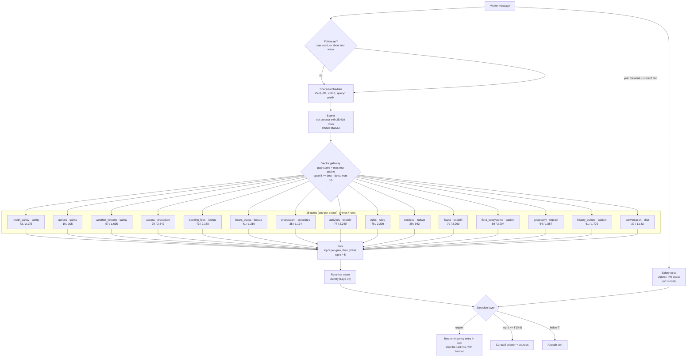

# Retrieval architecture

How a visitor's message becomes one curated answer: one shared embedding space, a vector gateway over 15 gates (one per knowledge sector), retrieval inside each gate, and a decision layer on top. Verified against the code on 2026-11-23: `mobile/src/core/knowledge/` (runtime), `experiments/nlu/export_nlu.py` (index build), `data/knowledge/sections/*.json` (gate configs), `mobile/assets/data/knowledge/policy.json` (shipped parameters).

> **Status in one line.** The design is a soft multi-gate router with a retrieval profile per gate. The shipped configuration opens all 15 gates on every query and uses one dense strategy for all of them. Today the effective behavior is global retrieval over the shared space, followed by the decision layer. Section 6 lists what is declared per gate and what actually runs.

## 1. The web

Gates are listed in their contract `order` (1 = highest priority). The tag after each name is the gate's declared retrieval profile.

## 2. The shared embedding space

One model embeds everything: every index row of every gate, the 15 gate descriptions, and the visitor's query. Because all scores live in one space, they are comparable across gates. The query is embedded once per turn, or twice for a fused follow-up.

| Property | Value | Where |
|---|---|---|
| Model | `e5-nlu-ft4-f16.gguf`: `intfloat/multilingual-e5-base` fine-tuned on park queries | `models/knowledge/`, manifest `embedder` |
| Dimensions | 768, L2-normalised, so cosine = dot product | `index.json` `dims` |
| Prefix | `"query: "` on rows and on queries (symmetric use of e5) | `export_knowledge.py` `PREFIX`, manifest `prefix` |
| Text as written | `strip_fillers` is false: rows and queries are embedded raw (whitespace collapsed) | `policy.json` |
| Runtime | llama.rn, its own context, never through the legacy `ModelManager` | `mobile/src/llm/embedder.ts` |
| Scoring | `index_scorer.onnx`, one MatMul of the query against all rows (onnxruntime). A JS fallback loop exists, but it runs ~0.46 s per query on Hermes | `scorer.ts`, `retrieve.ts` |

**Fine-tune** (`experiments/nlu/colab_train.py`, run in Colab):
- Training is contrastive. Each batch holds distinct entries, and every other entry in the batch is a negative, so there are no in-batch false negatives.
- The training pools are each entry's label, examples and app-layer queries (aug queries and follow-up conversations), plus the hubs.
- Every blind evaluation turn is removed from the training data, so neither the model nor the index has seen a blind query.

Recorded results, from the project notes of 2026-11-23 (not re-run here):

| Eval set | Accuracy |
|---|---|
| Sealed blind set v3 | 83.0 % (60.7 % under a strict judge) |
| Blind v2 | 85.3 % |
| Follow-up turns on v3 | 49 %, the weakest point |

## 3. What is indexed

The index has 25,410 rows. 25,395 are text rows, each owned by one entry. The other 15 are gate description rows.

| Row type | Source | Owner |
|---|---|---|
| Label | `sections/<s>.json` entry `label` | the entry |
| Examples | entry `examples` (visitor phrasings) | the entry |
| Augmented queries | `data/knowledge/app/aug_queries.json` (colloquial, misspelled, fragments; about 300 off-topic messages under `conversation.off_topic_question`) | the entry |
| Follow-up conversations | `app/followup_convs.json` (2-turn exchanges whose second turn this entry answers) | the entry |
| Hub rows | `app/hubs.json` (37 composite answers for broad questions, built from their members' facts) | the hub, placed in its first member's gate |
| Gate description | section `description` | the gate (counts only for the gate score) |

Ownership rules:
- **Redirects** (`app/redirects.json`): a redirected entry's rows are owned by its target. A meta reply gives its retrieval to a content hub, but stays in the catalog for featured chips.
- **Audience**: only `visitor` entries are exported (806 section entries + 37 hubs = 843).
- **The reply is not indexed.** What the chat shows is `app/natural_replies.json` (or the hub's reviewed reply), copied into the catalog as `short`.

## 4. The vector gateway

The gateway runs over the scores the scorer already computed, so it costs no extra model call.

1. **Gate score** = the max cosine over the gate's description row and every text row of every entry in the gate. Max, not a centroid: Phase 1 measured that a centroid router picks the wrong sector 27 % of the time.
2. **Open gates**: every gate whose score is at least `best gate score - delta`, best first, capped at `max_sections`. Ties are broken by gate id.
3. **Shipped values**: `delta` 2.0 and `max_sections` 15. Cosines span at most 2, so **every gate is open on every query**. The gateway still runs and reports the gate order (`RetrievalResult.gates`), but it filters nothing.

Why it is open, from the measurements (`docs/history/phase1-laya-report.md`, e5-base, n = 88):

| Routing | Top-1 | Correct answer in pool |
|---|---|---|
| Flat (no gateway) | 76.1 % | 95.5 % in top 5 |
| Hard gateway (best gate only) | 64.8 % (-11 points) | |
| Soft gateway (gates within 0.05 of best, up to 5) | | 95.5 % (4.9 candidates) |

A hard gate loses answers and a soft gate only matches flat retrieval. The NLU work then evaluated with every gate open (`export_nlu.py`: "top-1 is the global best entry, as evaluated"), and that configuration shipped.

**Re-measured with the fine-tuned embedder** (2026-11-23, `experiments/nlu/gateway_ab.py`: shipped ft4 index, phone-faithful replay of `retrieve.ts` with follow-ups and `T`; one deterministic run). Top-1 accuracy with hub credit:

| Set (n) | All open (shipped) | Soft δ 0.10, ≤5 | Soft δ 0.05, ≤5 | Soft δ 0.02, ≤3 | Hard (best gate) |
|---|---|---|---|---|---|
| dev (251) | **88.0 %** | 87.3 % | 87.3 % | 86.1 % | 84.9 % |
| test (259) | **80.7 %** | 79.5 % | 78.8 % | 79.2 % | 79.2 % |
| blind v2 (300) | **85.3 %** | 84.7 % | 83.7 % | 83.7 % | 82.7 % |
| blind v3, sealed (300) | **83.0 %** | 82.0 % | 81.7 % | 81.0 % | 79.0 % |
| follow-ups in v3 (39) | **48.7 %** | 41.0 % | 35.9 % | 33.3 % | 30.8 % |

The fine-tune does not make routing pay off. On standalone questions, soft gates tie with all-open (v3: all-open 230, δ 0.10 230, δ 0.05 231 of 261 correct). The whole loss is in follow-ups, because `retrieve.ts` picks a follow-up's gates from the current turn alone.

**Gates that look at the previous turn** (same script, same run conditions). For a fused follow-up, either the section scores are fused with the context's like entry scores (`fused`: `(cur + w * ctx) / (1 + w)`), or the previous turn's open gates stay open (`union`):

| Set (n) | All open | δ 0.05 turn only | δ 0.05 fused | δ 0.05 union | Hard, fused |
|---|---|---|---|---|---|
| dev (251) | 88.0 % | 87.3 % | 88.0 % | 87.6 % | 87.6 % |
| test (259) | 80.7 % | 78.8 % | 80.7 % | 80.7 % | 81.1 % |
| blind v2 (300) | 85.3 % | 83.7 % | 85.3 % | 85.7 % | 84.3 % |
| blind v3, sealed (300) | 83.0 % | 81.7 % | 83.3 % | 83.3 % | 81.7 % |
| follow-ups in v3 (39) | 48.7 % | 35.9 % | 48.7 % | 48.7 % | 51.3 % |

Context-aware gates remove the follow-up loss, but they gain at most 1 question per set over all-open: no measurable difference. With the fine-tuned space the global best entry already sits in the best gates, so a gate rarely changes the top-1. It saves no time either: gate scores need every row's cosine, so the scorer still multiplies all 25,410 rows.

To route again, export with a smaller `delta` and `max_sections`. Both are runtime parameters, so no code change is needed. Re-measure on a fresh blind set first: v3 is spent.

## 5. Retrieval inside a gate

For every entry, in every open gate:

1. **Entry score** = the mean of its best `score_topk` = 3 row cosines. One lucky row cannot win alone, and an entry with many phrasings is not penalised.
2. **Follow-up fusion** (when it applies, section 7): `s' = (s + w * c) / (1 + w)`, where `c` is the context score.
3. **Per-gate cut**: each open gate keeps its best `top_k` entries.
4. **Merge**: the per-gate survivors are sorted together and cut to `k` = 5.
5. **Minimum pool**: below `min_pool` = 1, the best entries overall are added.

All arithmetic is float32 and matches the Python reference to the bit (`__fixtures__/retrieval.json`, Jest).

## 6. Strategy per gate: declared vs running

Each section file declares a retrieval profile (`retrieval` and `clarification` in `docs/knowledge-contract.md`). The design for each profile (`docs/history/plan-knowledge-system.md`):

| Profile | Design intent | Gates |
|---|---|---|
| `safety` | dense + keyword triggers, low threshold, recall first, never abstain silently | health_safety, actions, weather_volcano |
| `lookup` | hybrid BM25 + dense (numbers, names), entity filters, strict threshold | booking_fees, hours_status, services |
| `procedure` | dense + entity filters (origin, sector), answers with steps | access, preparation |
| `explain` | dense over examples + label + short answer | activities, fauna, flora_ecosystems, geography, history_culture |
| `rules` | hybrid with heavy BM25 (perro, dron, fuego) | rules |
| `chat` | dense over short examples, canned replies | conversation |

What each gate declares, and what the shipped runtime does with it:

| Gate | Profile | `bm25_weight` | `top_k` declared | Entity filters declared |
|---|---|---|---|---|
| actions | safety | 0.30 | 2 | sector, date, group_size, visitor_type, emergency_type, people_count |
| health_safety | safety | 0.25 | 3 | none |
| weather_volcano | safety | 0.25 | 3 | none |
| access | procedure | 0.20 | 2 | origin, sector |
| booking_fees | lookup | 0.25 | 2 | sector, visitor_category |
| hours_status | lookup | 0.30 | 2 | sector, closure_type |
| preparation | procedure | 0.20 | 2 | trip_duration, sector |
| activities | explain | 0.35 | 2 | sector |
| rules | rules | 0.25 | 2 | none |
| services | lookup | 0.30 | 2 | sector |
| fauna | explain | 0.30 | 2 | animal_group, sector |
| flora_ecosystems | explain | 0.20 | 2 | none |
| geography | explain | 0.25 | 3 | landform, sector |
| history_culture | explain | 0.35 | 3 | volcano |
| conversation | chat | 0.30 | 2 | none |

| Declared field | Running today |
|---|---|
| `profile` | not read: every gate uses the same dense scoring (section 5) |
| `bm25_weight` | not implemented: there is no lexical index on the phone |
| `top_k` | overwritten: the exporter writes 5 for every gate (`export_nlu.py` `K`) |
| `entity_filters`, `needs` | not implemented: there is no entity extraction |
| `min_score` | null everywhere; the only threshold is the global `T` |
| `clarification` bank | not implemented: below `T` the app abstains instead of asking |
| `order` | only orders the gates in `sections.json`; gate ties are broken by id |

The safety profile's intent is still met, but outside the gates: by the text rules and the emergency path of the decision layer (section 8).

## 7. Conversation context (follow-ups)

A turn is read in the light of the previous one when either:
- it opens with a connective (`cue` regex: y, pero, entonces, eso, ahí, con, para...), or
- it has at most `max_words` = 5 words **and** its own best score is below `below` = 0.7.

In `concat` mode (shipped):
1. The engine embeds `previous text + current text` and scores it as context `c`.
2. It fuses that with the turn's own scores using `w` = 5, so the context dominates.
3. Fused turns chain: the context text accumulates, bounded to the last 60 words.

Two exceptions:
- Urgent turns never fuse, so a previous topic cannot push emergency entries out of the pool.
- The `T` floor is not applied to a fused turn, because it continues a park topic.

## 8. Decision layer

| Order | Step | Rule | Code |
|---|---|---|---|
| 1 | Safety rules, before any model | Regexes over folded text (lower case, explicit accent map, punctuation stripped, doubled vowels squeezed). **Urgent** (person or body plus danger, panic phrases) or **live status** (asking for today's state: closures, alerts, roads). A hypothetical frame ("si...", "en caso de...") disables the weak rules. Recall first: a false alarm costs one banner | `safety.ts` |
| 2 | Banner | Urgent wins over live status. Urgent shows the 123 entry's text; live status shows the offline notice. The banner sits above the reply and never replaces it | `policy.ts` `bannerFor` |
| 3 | Embedding failure | Urgent: the 123 entry under the banner. Live status: abstain under the banner. Neither: error | `engine.ts` |
| 4 | Reranker | It may only reorder the pool, never add or drop. It is skipped when any pool id is outside its training catalog. Shipped: none (Laya `enabled` false) | `rerank.ts` |
| 5 | Urgent decision | No threshold. The best `emergency_direct` entry in the pool (40 ids from `app/answer_policy.json`), else the 123 line | `policy.ts` `decide` |
| 6 | Normal decision | Answer the pool's top-1 when its score is at least `T` = 0.5 (`T` is the off-topic floor), else abstain with the fixed text | `policy.ts` `decide` |
| 7 | Reply | Always curated: `short` (natural reply), sources with URL and date, `last_verified`. No text is generated | `policy.ts` `answerFor` |

`T` was fitted on the blind dev split (`experiments/nlu/context_eval.py`, `evaluate.py`), together with the follow-up `w`, `max_words` and `below`.

## 9. Parameters (shipped `policy.json`)

| Parameter | Value | Layer |
|---|---|---|
| `delta`, `max_sections` | 2.0, 15 | gateway (all gates open) |
| `top_k` per gate | 5 (all gates) | gate retrieval |
| `score_topk` | 3 | entry score |
| `k`, `min_pool` | 5, 1 | pool |
| `followup` | mode concat, `w` 5.0, `max_words` 5, `below` 0.7, cue regex | context |
| `T` | 0.5 | decision |
| `emergency_direct`, `emergency_line_id` | 40 ids, `health_safety.national_emergency_number_123` | decision |
| `laya` | enabled false, reorder_only | reranker |

They are changed only through the exporter flags ([`architecture.md`](architecture.md#regenerating-the-assets)), never by editing the generated file.

## 10. Extending

| Goal | Change |
|---|---|
| Add a gate | A new `data/knowledge/sections/<id>.json` (contract, description, entries), its app-layer rows, then re-export. The gateway reads the gate list from the manifest, so no runtime code changes |
| Turn routing on | Measured no gain with ft4 (section 4). If needed later (for example, many more gates): fuse section scores with the context in `retrieve.ts`, export a smaller `delta`/`max_sections`, measure on a new blind set |
| Honor per-gate `top_k` | Have `export_nlu.py` write each section's `retrieval.top_k` instead of `K` |
| Per-gate thresholds (`min_score`) | Add a per-gate floor in `decide`, fit it on blind data |
| Lexical signal for lookup and rules gates | New code: a BM25 index in the export and a fused score in `retrieve.ts`; keep Python/TS parity fixtures |
| Clarifying questions | New decision branch for close top-2 candidates (design in `history/plan-knowledge-system.md`, "Clarification policy") |
| Laya reranker | Pass its gate (`history/phase3-architecture.md` §1.4), finish the tokenizer port in `src/llm/laya.ts`, set `laya.enabled` |

## 11. Measured improvement options (2026-11-23)

One deterministic run each on dev (251), test (259) and blind v2 (300) with the shipped ft4 index and policy. Baseline: 88.0 / 80.7 / 85.3 %. Blind v3 was not used. The analysis scripts were throwaway and are not in the repo; `experiments/nlu/gateway_ab.py` covers section 4.

| Option | Best result (dev / test / v2) | Verdict |
|---|---|---|
| Error split on v2 (44 errors) | 20 wrong section with the best gate also wrong, 17 right section wrong entry, 6 off-topic answered, 0 wrong abstentions | Gates cannot fix most errors |
| Ceiling: perfect reorder of the e5 top 3 | 96.4 / 89.6 / 94.7 % | Large headroom, if something could pick within the top 3 |
| Section score as a soft prior on entries (λ 0.05 to 1.0) | 87.6 / 81.5 / 84.7 % at best | No gain |
| Laya `run_rlcd6` (int8 ONNX, 83 ms p50 on the laptop) picking within the top 2 / 3 / 5 | 84.1 / 73.4 / 81.3 % at best (top 2) | Worse than e5 |
| Laya blended with e5, `s + 0.1 * p` | 88.8 / 81.5 / 86.3 % | +0.8 to +1.0 points; within noise, costs a 700 MB model and a tokenizer port |
| Laya "none of these" as an abstention signal | 82.5 / 74.5 / 77.7 % at best | Worse |
| Clarifying question when the top 2 entries are from different sections and within 0.02 | Asks 4 to 6 % of questions; at most 89.2 / 82.6 / 87.0 % if the visitor always picks right | +1 to +2 points, but it is a 2-option menu (the user ruled menus out on 2026-11-22) |
| Global `T` sweep 0.45 to 0.70 | 0.5 is best or tied | Keep |
| Per-gate `T` fitted on one set, tested on the others | ±1 question | Overfits; no gain |
| Data: bare "soroche" goes to `actions.report_altitude_sickness` | 4 of the v2/test errors | Cheap app-layer fix, but chosen after seeing the failures, so it cannot be measured fairly on these sets |

## 12. Known gaps

- The declared per-gate strategies (section 6) do not run. Either implement them or remove them from the contract.
- Follow-up turns are the weakest point: 49 % on the sealed set.
- `valid_until` is ignored by both the exporter and the runtime, so expired answers are still served.
- No clarification: an ambiguous question gets either a guess (top-1 at or above `T`) or an abstention.
