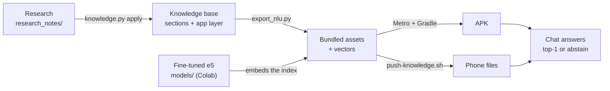
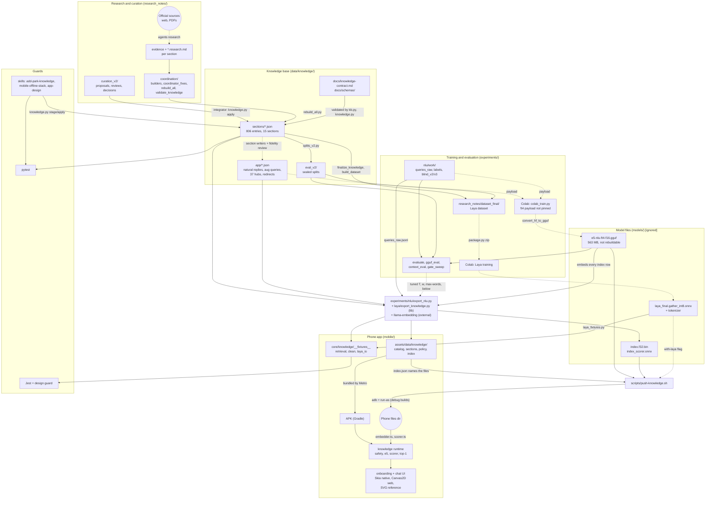

# System map

How every part of the repo connects: which file feeds which, through what script, and what breaks downstream when something changes. Each edge names the script or code that creates it. Last broad verification: 2026-11-23. Knowledge counts, training-payload paths, and scene renderers were checked on 2026-11-25.

For task-first navigation to individual modules and tests, see the [agent index](agent-index/README.md).

Legend: solid arrow = a script or code reads/writes it; dotted = manual or off-repo step; `[ignored]` = not in git.

## The spine

Read this first; the full web below adds every script and side branch.

## The whole web

## Flows

### 1. Authoring knowledge (research to `sections/`)

| Step | Reads | Writes | Code |
|---|---|---|---|
| Research a topic | official sources | `research_notes/Conocimiento turístico de Los Nevados/<section>/` evidence, `<section>.research.md` | agents; `curation_v2/tools/fetch_evidence.py` for curation rounds |
| Add, update, delete entries | contract, schema, current section | `data/knowledge/sections/<section>.json`, audit block in `<section>.research.md`, `coordination/knowledge_additions.json` | `.agents/skills/add-park-knowledge/scripts/knowledge.py` (`stage`, `check`, `apply`, under `coordinator_fixes.lock`) |
| Rebuild from builders | per-section builders + `coordinator_fixes.py` | all sections | `coordination/rebuild_all.py`, checked by `regen_test.py` |
| Validate | sections | report | `coordination/validate_knowledge.py`, `experiments/laya/kb.py validate` |
| Curation rounds | proposals, reviews | sections (through `knowledge.py apply`) | `research_notes/curation_v2/` (plan in `PLAN.md`) |

`sections/` is never hand-edited: `rebuild_all.py` would drop the change. The contract lives in `docs/knowledge-contract.md`; three readers depend on its path (`kb.py`, `knowledge.py`, `tests/test_add_park_knowledge.py`).

### 2. App layer (`sections/` to what the phone says)

`data/knowledge/app/` sits on top of the sections, keyed by entry id ([README](../data/knowledge/app/README.md)): `natural_replies.json` is the text the chat shows, `aug_queries.json` and `followup_convs.json` add index rows, `hubs.json` adds composite answers, `redirects.json` points one entry's rows at another. Written by section writers, then a fidelity review. No script derives it from `sections/`, so a new entry needs its rows added here or the export aborts.

### 3. Shipping (`sections/` + `app/` to the phone)

| Step | Reads | Writes | Code |
|---|---|---|---|
| Export | `sections/`, `app/`, `experiments/nlu/work/queries_raw.jsonl`, `models/knowledge/e5-nlu-ft4-f16.gguf`, external `llama-embedding` binary | `mobile/assets/data/knowledge/*.json`, `mobile/src/core/knowledge/__fixtures__/{retrieval,clean}.json`, `models/knowledge/{index.f32.bin,index_scorer.onnx}` | `experiments/nlu/export_nlu.py`, run in the `experiments/laya` uv env, importing `experiments/laya/export_knowledge.py` and `experiments/nlu/kb.py` |
| Bundle | `mobile/assets/` | APK | Metro + Gradle (`mobile/android`, generated) |
| Side-load | `index.json` (file names), `models/knowledge/` | app files dir on the phone | `mobile/scripts/push-knowledge.sh` |
| Load | bundled JSON + side-loaded files, sizes checked against `index.json` | `KnowledgeEngine` | `mobile/src/llm/knowledgeRuntime.ts`, `embedder.ts`, `scorer.ts` |

Exact export command: [`architecture.md`](architecture.md#regenerating-the-assets).

### 4. The embedder (`e5-nlu-ft4-f16.gguf`)

multilingual-e5-base fine-tuned on park queries in Colab (`experiments/nlu/colab_train.py` is pasted into a cell and reads an uploaded payload), then converted to GGUF with llama.cpp in Colab. The payload builder `experiments/nlu/build_payload.py` is committed. Its usage writes `experiments/nlu/work/payload_ft5.json` and reads `research_notes/depth_v1/blind_v4/`, which is not tracked. The exact payload used for the shipped `e5-nlu-ft4-f16.gguf` is not pinned; `experiments/nlu/work/colab_payload.b64` is ignored. A clean checkout cannot recreate the trained GGUF and its original training inputs. The exporter rebuilds vectors, the scorer, and fixtures from an available GGUF.

### 5. Evaluation and policy tuning

| Data | Used by | Feeds |
|---|---|---|
| `experiments/nlu/work/labels_*.jsonl`, `blind_v2/`, `blind_v3/` (sealed) | `evaluate.py`, `gguf_eval.py`, `context_eval.py`, `gate_sweep.py` | the policy values passed to the exporter (`T`, `w`, `max-words`, `below`), stored in `policy.json` `fitted_on` |
| `data/knowledge/eval_v2/` (sealed, from `experiments/laya/splits_v2.py`) | `research_notes/dataset_final/tools/build_dataset.py`, `build_splits.py` | Laya dataset splits |

Sealed splits are read for final numbers only; tuning on them invalidates them.

### 6. Laya reorderer (kept, off)

`sections/` + curation v2 tables -> `dataset_final/tools/finalize_knowledge.py` -> `build_dataset.py` (also reads `eval_v2/` and `laya_ft/eval.jsonl`) -> `package.py` zip `[ignored]` -> Colab training -> `models/laya_final_rlcd6_raw/.../laya_final.gather_int8.onnx` -> `experiments/laya/laya_fixtures.py` -> `mobile/src/core/knowledge/laya/__fixtures__/laya_io.json`. On the phone `src/llm/laya.ts` is a stub until its tokenizer port passes that fixture; `policy.laya.enabled` is false, so the engine never calls it.

### 7. Onboarding scene

`mobile/src/onboarding/scene/preset.ts` (the `SceneDoc`) -> `SceneCanvas.tsx` with `canvas2d/drawScene2d.ts` (web onboarding) and `SceneCanvas.native.tsx` with `skia/drawScene.ts` (native). `NevadoScene.tsx` is the SVG reference used by the web Lab and design previews. The Lab (`/lab`, web) edits a copy in `localStorage`; edits return to the code through "Copiar JSON" by hand. `src/chat/headerScene.ts` derives the chat header from the same preset.

### 8. Legacy (LLM era, still wired to one screen)

`data/suites/` + `src/nevados_bench/` (`export_mobile.py` and its imports) -> `mobile/assets/data/world.json` and `mobile/src/core/__fixtures__/{prompts,replays}.json` `[ignored]` -> `app/settings.tsx` (station list) and the legacy Jest tests in `src/core/__tests__/`. Nothing in the knowledge path reads them.

## Blast radius: if you change X, redo Y

| You change | Then |
|---|---|
| An entry in `sections/` | its `app/` rows -> export -> `npm test` -> push vectors. `validate_knowledge.py` before |
| `data/knowledge/app/*` | export -> `npm test` -> push vectors |
| The embedder GGUF | export (all vectors change) -> push all three files -> rerun `gguf_eval.py` on the blind sets |
| `policy.json` values | export with the new flags (never edit the generated file) -> `npm test` |
| `experiments/laya/export_knowledge.py` | it is a library of `export_nlu.py`: rerun the export and compare fixtures. Never run its `main()` (writes the old `e5-top1-v1` format) |
| `docs/knowledge-contract.md` or `docs/schemas/` | `uv run pytest`, `kb.py validate`, `validate_knowledge.py`; keep the paths (code reads them) |
| A new scene body kind | `canvas2d/drawScene2d.ts`, `skia/drawScene.ts`, `NevadoScene.tsx`, and the Lab's `params.ts` |
| A native dependency | rebuild the APK; check the whitelist in the `mobile-offline-stack` skill |
| `src/nevados_bench/` | `uv run pytest`; `world.json` regen if the settings screen still needs it |

## Nodes that are not rebuildable from git

| Node | Why | Mitigation |
|---|---|---|
| `models/knowledge/e5-nlu-ft4-f16.gguf` | trained in Colab from an uncommitted payload | keep an off-machine backup |
| `models/laya/` | Colab run `run_rlcd6` (its reports and predictions live in the ignored `results/laya_run_rlcd6/`) | only matters if Laya is turned on |
| `experiments/nlu/work/colab_payload.b64` `[ignored]` | the frozen training payload of ft4 | keep with the GGUF backup |
| external `llama-embedding` binary | built from llama.cpp outside the repo (`~/.cache/llama.cpp-src`) | needed to export; rebuild from llama.cpp |

## Where the agents plug in

| Skill | Owns |
|---|---|
| `add-park-knowledge` (`.agents/skills`, linked from `.claude/skills`) | flow 1, and the hand-off to flows 2-3 |
| `mobile-offline-stack` | flows 3, 6, 8 and the app's contracts |
| `app-design` | flow 7 and every screen's tokens and components |
| `hackathon-lean` | how to scope any change |
