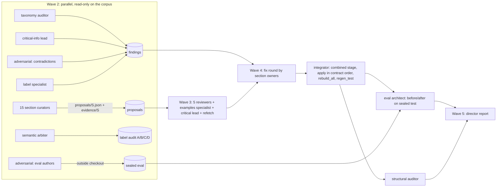
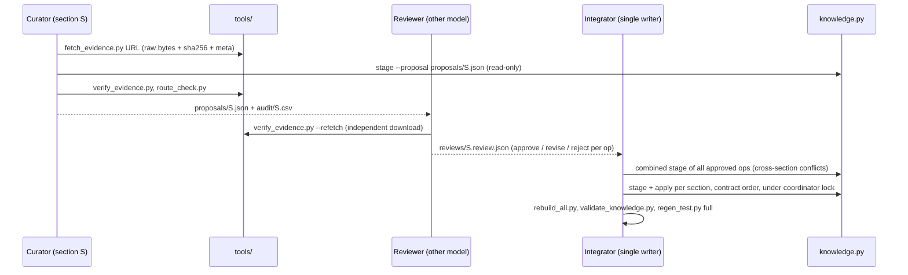

# Knowledge base curation v2 — plan

Goal: make the curated FAQ base of PNN Los Nevados more correct, better sourced and easier to
discriminate for e5 + gateway + Laya, and measure the gain on a sealed evaluation set that nobody
tuned on. More FAQs is not the goal.

Started 2026-11-22. Orchestrator: Claude Opus 5.5 (this thread). Hackathon: 2026-11-26.

## Non-goals

- No new production model and no Laya retrain here. A 322M full fine-tune does not fit the local
  GTX 1650 (4 GB). The v2 training rows are produced; the retrain is a recommendation (Colab).
- No Phase 3 app gateway. The benchmark uses the **reference config** from
  `docs/plan-knowledge-system.md` (see "Retrieval config"). It is not an app measurement.
- No on-device measurements (RAM, latency) unless a phone is attached (`adb devices` was empty on 2026-11-22). This is about benchmarks, not telephone numbers in answers.

## System view

## Write path for one change

## Gates

| Gate | Check | Blocking |
|---|---|---|
| Evidence | `verify_evidence.py` fail = 0; numbers flags explained; `--refetch` by a non-author; a refetch miss blocks the op until resolved | yes |
| Entailment | Reviewer (other model family) reads each quote vs claim | yes |
| Routing | `route_check.py`: removed examples still reach their entry in top 3 | yes |
| Structure | `stage`/`apply` ok, `validate_knowledge.py` Errors 0 / flags 0, `regen_test.py full` identical | yes |
| Leakage | `leak_check` between corpus examples, training rows and sealed eval | yes |
| Self-approval | Author ≠ reviewer, reviewer of another model family | yes |

LOO top-1 from `inventory.py` is a locator of confusable entries, not a target: adding
near-duplicate examples raises it mechanically. Acceptance is the sealed eval.

## Operation policy

- **Metadata-only ops** (`label`, `examples`, `hard_negatives`, `related`, `tags`) are the main
  retrieval lever. No evidence needed. Worklists: `audit/inventory_before/confusable_pairs.csv`
  (693 pairs) and per-entry `loo_top1`.
- **Factual ops** (`answer`, `sources`, dates) only for real errors, unsupported claims and
  vigencia. Every cited URL needs a fetched quote.
- **Deletes** only with a reason, an inspected reference list and, for merges, `replace_with`.
  Never delete for textual similarity alone.
- **Temporal policy**: an answer about changeable state (alerts, closures, hours, fees, road
  status, permits) states the date of the information, never claims to know the current state, and
  points to the official channel. `last_verified` is set; `valid_until` only when the source gives
  an expiry.

## Retrieval config (reference, `experiments/laya/retrieval.py`)

e5-base, `query: ` prefix. Gateway: section score = max cosine over that section's vectors
(examples + labels + section description); keep sections with score ≥ max(τ_gate, top − δ),
δ = 0.05, at most 5. Each kept section passes its `retrieval.top_k` entries; the merged pool is
ordered by cosine and cut to k ∈ {3, 4, 5}. BM25 weights in the section files are not used (dense
only). Flat pools (the `laya_ft_A` training config) are reported separately.

## Evaluation design

- Sealed set written by two adversarial agents from an answers-only view (no `examples`), stored
  outside the checkout until the corpus is frozen, labels verified by the semantic arbiter.
- Rows carry `family` (one intent, several surface forms); splits are family-disjoint:
  `dev_gate` (fit thresholds) and `test_blind` (report only). Fixed scenario mix, documented in
  the eval README, including a plain natural slice.
- Before vs after: same sealed `test_blind`, thresholds fit on `dev_gate` only, Wilson intervals.
- The historical 1,790-row eval is reported as **legacy, not blind**. It chooses nothing.
- New FAQs get their own rows after the freeze (unseen-topic slice for `laya_ft_A`).

## Assignment (32 agents)

Section curators may change only entries of their own section. Cross-section moves and merges go
to `findings/` and are implemented in wave 4 by the owning curators.

| # | Role | Model | Wave | Scope |
|---|---|---|---|---|
| 1 | Director: arbitration + final report | codex/gpt-6-luna | 3–5 | conflicts, decision log, recommendations |
| 2 | Taxonomy, IDs, duplicates | codex/gpt-6-luna | 2 | all sections, cross-section overlap |
| 3 | Semantic arbiter, multiple valid answers | codex/gpt-6-luna | 2–3 | A/B/C/D audit on train/dev; sealed-eval labels |
| 4 | Critical info, safety, vigencia | codex/gpt-6-luna | 2–3 | critical answers; second review of critical ops |
| 5 | Retrieval evaluation architect | codex/gpt-6-luna | 2–4 | retrieval.py, bench_v2.py, splits, leak check |
| 6 | Integration, validation, release | codex/gpt-6-luna | 4–5 | single writer of the corpus |
| 7–16 | Curators (10) | antigravity/gemini-3.8-flash | 2, 4 | access, preparation, activities, rules, services, fauna, flora_ecosystems, geography, history_culture, conversation |
| 17–21 | Curators (5) | cursor/grok-4.7 | 2, 4 | actions, health_safety, weather_volcano, booking_fees, hours_status |
| 22 | Adversarial: contradictions, staleness | cursor/grok-4.7 | 2 | whole corpus |
| 23 | Adversarial: eval author A (confusables, near-miss, out-of-scope, temporal) | cursor/grok-4.7 | 2 | sealed eval |
| 24 | Adversarial: eval author B (natural, colloquial, typos, compound, clarification) | cursor/grok-4.7 | 2 | sealed eval |
| 25 | Reviewer: actions, health_safety, weather_volcano | claudeAgent/claude-haiku-5-5 | 3 | |
| 26 | Reviewer: access, booking_fees, hours_status | claudeAgent/claude-haiku-5-5 | 3 | |
| 27 | Reviewer: preparation, activities, rules | claudeAgent/claude-haiku-5-5 | 3 | |
| 28 | Reviewer: services, fauna, flora_ecosystems | claudeAgent/claude-haiku-5-5 | 3 | |
| 29 | Reviewer: geography, history_culture, conversation | claudeAgent/claude-haiku-5-5 | 3 | |
| 30 | Label specialist (Laya option labels) | claudeAgent/claude-haiku-5-5 | 2 | |
| 31 | Examples specialist (new/changed examples) | claudeAgent/claude-haiku-5-5 | 3 | |
| 32 | Structural integrity auditor | claudeAgent/claude-haiku-5-5 | 5 | |

Safety-critical sections go to the curator model that passes the canary (wave 1.5). Phase 2
record: Gemini 3.8 Flash fabricated evidence; that is why every quote is checked against fetched
bytes and refetched by a non-author.

## Rollback

Every `apply` keeps backups in `coordination/addition_transactions/<id>`; the registry
`coordination/knowledge_additions.json` is the only new input to the rebuild. Rollback = restore
`sections_before` hashes by removing the registry and running `rebuild_all.py` (verified
deterministic on 2026-11-22: `regen_test.py full` reproduced all 15 files byte for byte).

## Model substitutions (logged)

- 2026-11-22: Grok runs on `cursor/grok-4.7`, by the user's instruction ("lanza el de grok con
  cursor"). Cursor offers no Grok 4.6. The first OpenCode launch (`github-copilot/grok-4.6`) failed
  with "Model not found" before writing any file.
- 2026-11-22 canary result: Grok 4.7 (actions) produced 36 fetched evidence items, refetch clean,
  0 fail; Gemini 3.8 Flash (services) produced metadata only and marked 26/26 sources primary_ok
  without reading any (caught by `audit_check.py`, added after the canary). Decision: the four
  remaining safety-critical sections (health_safety, weather_volcano, booking_fees, hours_status)
  stay with Grok as planned; Gemini sections get the stricter audit gate and a non-author refetch.
