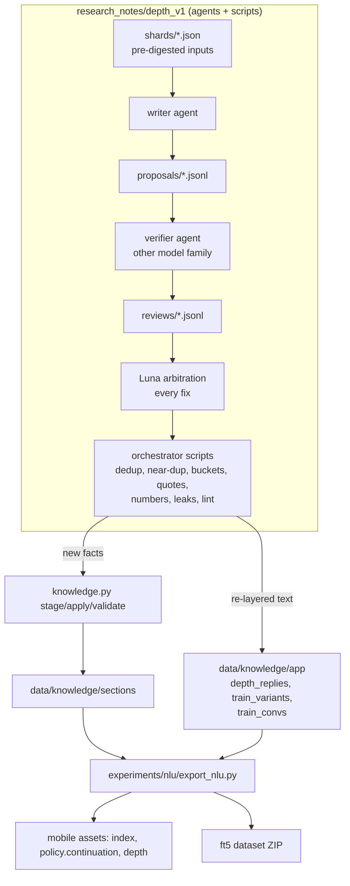
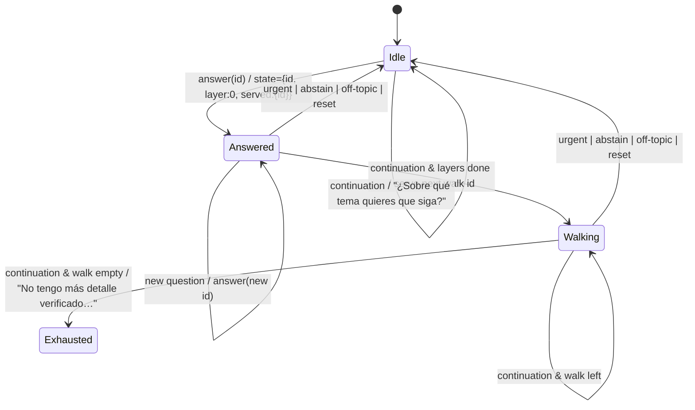

# MISIÓN SDD: LOS NEVADOS — LLENAR LA BASE DE VARIANTES, FOLLOW-UPS, PROFUNDIDAD Y RESPUESTAS QUE NUNCA SE REPITEN

Eres el **orquestador** en OpenCode, dentro de `/home/cruz1122/dev/hacka-airplane`. Esta misión es
**spec-driven** y **este archivo es la única fuente**: la spec aprobada está más abajo, en tres partes.

- **Parte A — Requirements**: qué tiene que pasar, y la tabla de aceptación A1–A12.
- **Parte B — Design**: cómo se hace.
- **Parte C — Tasks**: quién hace qué, en qué orden, y cuándo una tarea está terminada.

1. Lee el archivo completo antes de empezar.
2. Ejecuta la Parte C de T0 a T9, siguiendo el orden de dependencias. Una tarea cierra solo cuando
   su **Done** está medido por script y escrito en `research_notes/depth_v1/decisions/Tn.md`.
3. No implementes nada que la spec no pida. Si la spec choca con la realidad del repo, registra el
   conflicto en `decisions/DECISION_LOG.md`, aplica la corrección mínima y sigue. Detente solo ante
   un bloqueo técnico real o antes de una acción destructiva.

## LA META (no la pierdas de vista)

**Llenar las 806 entradas de variantes, conversaciones de follow-up y profundidad con fuentes, y
lograr que si preguntas lo mismo otra vez, la respuesta salga dicha distinto cada vez.**

| Qué | Meta dura |
|---|---|
| Variantes de pregunta nuevas y aprobadas | **≥20 por entrada** (≥16,000) |
| Conversaciones multi-turno nuevas y aprobadas | **≥8 por entrada** (≥6,400) |
| Capas de profundidad para "sigue" | **L1 en ≥90%, L2 en ≥70%** de las entradas no exentas |
| Paráfrasis de la respuesta (mismos hechos, distinta redacción) | **≥8 por entrada** y **≥4 por capa** |
| "misma pregunta ×8" sobre cada entrada | **8 textos distintos** (emergencias: solo paráfrasis doble-aprobadas) |
| Oraciones sin soporte / hechos cambiados en paráfrasis | **0** |
| "pregunta → sigue ×4" sobre las 806 | **0 repeticiones**, ≥3 turnos distintos donde haya fuentes |

- Una entrada debajo de su meta **no está terminada**. Lánzale una ronda de top-up con otro
  escritor, o una investigación de fuentes (T3b).
- Solo se acepta `no_headroom` cuando la investigación de fuentes públicas oficiales o académicas
  también falló, y debe quedar con la razón escrita.
- La fidelidad a las fuentes es la única restricción que nunca se negocia por volumen.

## Reglas no negociables

1. Habla con el usuario en español. Código, ids, docs y commits van en inglés.
2. **Nunca edites a mano `data/knowledge/sections/`.**
   - Los hechos nuevos entran solo por `add-park-knowledge` (`knowledge.py stage → apply →
     validate_knowledge.py`, Errors: 0), con citas literales.
   - El app layer solo reorganiza hechos que ya están en la entrada.
   - Los archivos integrados los escribe un script, nunca una persona ni un agente a mano.
3. Las advertencias de seguridad y reglas quedan en L0. El L0 de las entradas con `kind: safety` o
   `kind: rule` no cambia ni un byte.
4. Nada de menús, pantallas nuevas ni respuestas generativas.
5. blind_v4 se escribe y se sella **antes** de que exista una sola variante nueva. Nadie abre
   `v4_sealed` después de sellarlo.
6. Nadie aprueba su propio trabajo.
   - El escritor y el verificador son de **familias distintas**.
   - `nv-go` y `nv-zen` son el mismo modelo y nunca se verifican entre sí.
   - Todo `fix` lo arbitra una sesión de `nv-luna` que no vio ese shard.
7. **Presupuesto de contexto:**
   - Cada hijo recibe un shard pre-digerido por script, con rutas exactas y sin directorios de
     evidencia enteros.
   - Su set de lectura no pasa del 40% de su ventana.
   - Escribe skeleton-first: un JSONL por shard, fila a fila.
   - Si un hijo no produce archivo en 2× el tiempo esperado, revisa el mtime una vez, cancela y
     re-shardea.
8. No leas `.env` ni credenciales. No hagas commit ni push salvo que el usuario lo pida. No envíes
   datos del repo a servicios externos; la investigación web de fuentes públicas sí está permitida.
   No toques cambios ajenos a la misión (revisa `git status` en T0).
9. No entrenes ft5 ni hagas benchmarks del teléfono. Deja el paquete y el handoff.
10. Reporta honestamente lo no verificado. Ningún control cuenta como pasado si no lo corriste y
    leíste su salida.

## Roster (Parte B §8): créalo en T1

| Agente | Modelo | Familia |
|---|---|---|
| `nv-go` | `opencode-go/deepseek-v4.1-flash` | DeepSeek |
| `nv-zen` | `opencode/deepseek-v4.1-flash-free` | DeepSeek |
| `nv-luna` | `openai/gpt-6-luna` | Luna |

- En shards pares, escribe DeepSeek (alternando go y zen) y verifica Luna.
- En shards impares, escribe Luna y verifica DeepSeek (alternando zen y go).
- Si zen devuelve rate-limit 2 veces seguidas, pasa el shard a go y regístralo.
- Cada fila lleva `by: "<agente>/<modelo exacto>"`.

## Paralelismo recomendado

```
T1 ── T5b (paráfrasis L0 ya; las de capas tras T3c) ─┐
T0 ─┬─ T3a → T3b → T3c ─────────────┐
T1 ─┼─ T2 (v4 sellado) ─┬─ T4 ─┐    │
    │                   └─ T5 ─┴─ T6┼─ T8 → T9
    └─ T7 (runtime, con layers stub; cierra tras T3c) ─┘
```

Mantén varios shards en vuelo a la vez, sin pasarte del presupuesto de contexto por hijo.

## Respuesta final (solo estos puntos, en español)

1. Cómo probarlo: "háblame de los frailejones" → "sigue" ×3, con lo que responde cada turno.
2. Tabla de aceptación A1–A12: valor medido frente a la meta, y cuáles fallaron.
   Incluye un ejemplo de "¿qué son los frailejones?" ×3 con los 3 textos distintos.
3. Variantes y conversaciones: escritas, aprobadas, descartadas, `fix` y pares juzgados, por
   sección.
4. Profundidad: L1/L2 por sección, entradas con fuentes nuevas, y `no_headroom` con sus razones.
5. Baseline ft4 en v4_dev y resultado del A/B de índice.
6. Ruta, tamaño y SHA-256 del ZIP de ft5, más el hash de `v4_sealed`.
7. Roster: quién verificó a quién y los reasignados por rate-limit.
8. Bloqueos, riesgos y lo no verificado.
9. Archivos tocados fuera de `research_notes/depth_v1/`, sin commits.

---

# PARTE A — REQUIREMENTS

Status: approved for execution. Spec-driven: Part A (what), Part B (how), Part C (who, in what order, done when).
Do not implement anything a requirement here does not ask for.

## North star

**Fill the knowledge base with sourced variants and follow-ups.** Every one of the 806 entries ends
with:

- many more ways to be asked;
- many more conversations that lead to it;
- depth for "sigue": at least 2 extra sourced layers whenever any source supports them;
- **many ways to answer**: asking the same thing again gets a differently worded reply with the
  same facts, every time.

Volume is the goal. Fidelity to sources is the constraint that is never traded.

## Baseline (2026-11-23, re-measured in T0)

| Item | Today |
|---|---|
| Entries / sections | 806 / 15 |
| Corpus examples | 10,297 (median 12 per entry) |
| `aug_queries.json` | 10,517 (median 12 per entry) |
| `followup_convs.json` | 805 entries, ~4 two-turn convs each |
| Entries with non-null `answer.detail` | 163 (zero in flora, fauna, weather_volcano, health_safety, rules, conversation) |
| Depth served on "sigue" | none (cue regex misses "sigue/más/cuéntame más/por qué"; engine keeps no last entry) |
| ft4 follow-up accuracy (v3) | 49% |
| Reply texts per entry | 1 (`natural_replies.json`); the same question always gets the same text |

## Functional requirements (EARS)

### R1 — Query variants (volume)

- **R1.1** Every entry SHALL gain **≥20 new approved query variants**. That is ≥16,000 in total;
  `conversation` entries are exempt beyond 10.
- **R1.2** Each entry's variants SHALL follow this mix, ±1 per bucket:
  - 6 colloquial Colombian;
  - 4 misspelled or without accents;
  - 3 fragments of 1–4 words;
  - 3 indirect or situational ("voy con mi abuela de 70…");
  - 2 English;
  - 2 questions about a single specific fact of the answer.
- **R1.3** A variant SHALL be answerable by its entry's current answer. A variant that needs a fact
  not in the entry is `drop`.
- **R1.4** WHEN two variants of one entry have e5 cos ≥0.93, or match after normalisation, THE
  pipeline SHALL keep one.
- **R1.5** WHEN a variant has cos ≥0.88 to another entry's text, THE pipeline SHALL send the pair
  to pair judgment (`distinct | also_answers | query_dependent`). `query_dependent` rows SHALL NOT
  be used for training.

### R2 — Follow-up conversations (volume)

- **R2.1** Every entry SHALL gain **≥8 new approved multi-turn conversations** in which the last
  turn is answered by that entry. That is ≥6,400 in total.
- **R2.2** Per entry, the conversations SHALL include:
  - 3 two-turn conversations whose first turn is a specific question about a `related` entry;
  - 2 two-turn topic switches (the first turn is about an unrelated entry);
  - 2 three-turn chains;
  - 1 elliptic turn ("¿y para niños?", "¿y cuánto cuesta?").
- **R2.3** Every turn in a conversation SHALL carry the id of the entry that answers it, so that
  intermediate turns are labelled too.
- **R2.4** No conversation turn SHALL be a bare continuation cue (R4.1). Those cues are handled by
  rule, not by retrieval.

### R3 — Depth layers for "sigue" (volume with sources)

- **R3.1** Every entry with sources SHALL get **2 depth layers**:
  - L1 explains why or how;
  - L2 gives specifics (numbers, where, when).

  Each layer SHALL have 40–70 words. `conversation` and `kind: chat` entries are exempt.
- **R3.2** Every layer sentence SHALL list its support: a corpus field or a literal quote ref. A
  sentence without verified support SHALL be removed.
- **R3.3** IF an entry's current sources cannot support L1/L2, THEN a research task SHALL look for
  official or academic public sources and propose them through `knowledge.py` with quotes. Only if
  that also fails is the entry marked `no_headroom`, with the reason logged.
- **R3.4** Target: **≥90% of non-exempt entries** with L1, and **≥70%** with L2. The rest are
  `no_headroom`, each with a logged reason.
- **R3.5** New facts SHALL enter the corpus only through `add-park-knowledge`
  (`knowledge.py stage → apply → validate_knowledge.py`, Errors: 0). The app layer SHALL only
  re-layer facts that are already in the entry.
- **R3.6** Safety and rule caveats SHALL stay in L0, never only in a deeper layer.
  - For entries with `kind: safety` (77) or `kind: rule` (123), the canonical L0 text SHALL remain
    byte-identical.
  - Their paraphrases (R6) SHALL contain every caveat, number and step of the canonical text.

### R4 — Runtime continuation

- **R4.1** WHEN the whole message, accent-folded and ≤6 words, matches the continuation cue
  (`sigue, siga, continua, mas, que mas, y que mas, cuentame mas, dime mas, mas detalle(s),
  explicame mejor, amplia`, plus typos) AND there is a last answered entry, THE engine SHALL serve
  that entry's next unserved layer without embedding.
- **R4.2** WHEN the layers are exhausted, THE engine SHALL serve the next unserved entry of the
  `walk` (a related id), with a bridge of one fact-free clause.
- **R4.3** WHEN the walk is also exhausted, THE engine SHALL say "No tengo más detalle verificado
  sobre esto" and name 2 related topics in text. No menu.
- **R4.4** WHEN a continuation cue arrives with no last answered entry, THE engine SHALL reply
  "¿Sobre qué tema quieres que siga?".
- **R4.5** WHEN the message is "por qué" alone, THE engine SHALL serve the unserved `why` layer if
  one exists. Otherwise the message follows the normal follow-up path.
- **R4.6** WHEN retrieval returns the last answered entry again (the same question re-asked),
  THE engine SHALL serve the next unserved paraphrase of that entry's L0 (R6). It SHALL never
  repeat the text just shown.
- **R4.7** WHEN a turn is urgent, abstains or is off-topic, or the context is reset, THE engine
  SHALL clear the continuation state.
- **R4.8** WHEN `policy.continuation` is null or missing, THE engine SHALL behave exactly as today.

### R6 — Reply variants: same question, different answer every time

- **R6.1** Every non-exempt entry SHALL have **≥8 approved paraphrases of L0** (the canonical L0
  plus 7 or more). Each depth layer SHALL have **≥4 approved paraphrases**. In total that is
  ≥6,000 L0 paraphrases plus the layer paraphrases.
- **R6.2** Each paraphrase SHALL carry exactly the facts of its source text: no added fact, no
  dropped caveat, and identical numbers, units, dates, names and phone numbers, all checked by
  script.
- **R6.3** Paraphrases SHALL actually differ.
  - Within an entry, every pair SHALL have character-trigram Jaccard < 0.55.
  - No two paraphrases SHALL share their first 4 words.
  - The set SHALL use at least 3 different structures: direct answer first, context first,
    advice first, or a question back that is answered at once.
- **R6.4** Register SHALL vary within limits: warm, neutral, brief and more explained. It SHALL
  stay natural Colombian Spanish addressed to "tú", with no slang that changes meaning, no emojis
  and no jokes in `kind: safety` entries.
- **R6.5** WHEN an entry is answered again in the same app session, THE engine SHALL serve the
  next unserved paraphrase.
  - The order is shuffled per session from a seed.
  - After all paraphrases are used, the engine reshuffles and never starts with the text just
    shown.
  - This applies to L0, to every depth layer, and to walk entries.
- **R6.6** Exceptions:
  - `emergency_direct` entries (40, `knowledge/answer_policy.json`) SHALL rotate only among
    paraphrases that a second verifier approved for 100% caveat and step coverage. If an entry
    has fewer than 3 such paraphrases, it keeps its canonical text. Consistency beats variety in
    an emergency.
  - `kind: chat` entries SHALL rotate freely.

### R5 — Evaluation and ft5 readiness

- **R5.1** Before any new variant or conversation is written, blind_v4 SHALL be written by
  agents that have never seen the corpus, then labelled, split and sealed. Contents:
  - single-turn: ≥600 rows;
  - multi-turn: ≥300 follow-up turns;
  - continuation: 150 positives and 150 negatives.
- **R5.2** New variants and conversations SHALL have 0 leaks against v4: exact match or e5 cos ≥0.93.
- **R5.3** A reproducible ft5 dataset ZIP SHALL be produced, with no training run. It contains:
  - training rows;
  - hard-negative clusters;
  - v4-dev, and the v4-sealed hash;
  - validators and `MANIFEST.json`;
  - `QUALITY_REPORT.md` and `COLAB_HANDOFF.md`.

## Non-functional requirements

- **N1 Fidelity:** 0 unsupported sentences in depth layers and 0 fact changes in paraphrases.
  Checks:
  - a script verifies 100% of quotes and numbers;
  - a different model family verifies entailment on 100% of `health_safety` and `rules`, and on
    ≥10% of every other section.
- **N2 Label quality:** a reviewer from another model family judges every variant and every
  conversation turn (`ok | fix | drop`), and Luna arbitrates every `fix`.
- **N3 Index size:** the phone index does not grow by default. New rows go to the training pool. A
  row enters the index only if an index-only A/B on v2 with ft4 shows a gain.
- **N4 No regression:** ft4 single-turn accuracy on v4-dev with the final index ≥ with today's
  index (Wilson CI reported).
- **N5 Reproducibility:** every artifact is generated by a script from reviewed JSONL, and its
  inputs are hashed in a manifest.
- **N6 Context budget:** each subagent's read set stays under 40% of its window. Work is sharded
  and written skeleton-first.

## Acceptance (the mission is done only when all hold)

| Id | Check | Pass |
|---|---|---|
| A1 | approved new variants per entry (script) | ≥20 for 100% of non-conversation entries |
| A2 | approved new conversations per entry | ≥8 for 100% of entries |
| A3 | L1 / L2 coverage of non-exempt entries | ≥90% / ≥70%, every gap logged `no_headroom` with a reason |
| A4 | unsupported depth sentences | 0 |
| A5 | E2E "ask → sigue ×4" over all 806 entries | 0 repeated replies; ≥3 distinct turns where headroom exists |
| A6 | continuation detector on v4-dev | precision ≥98%, recall ≥90% |
| A7 | urgent clears state; null policy = today | unit tests green |
| A8 | leaks vs v4 | 0 |
| A9 | `validate_knowledge.py`; `export_nlu.py` + lint; mobile tests, typecheck, lint | all green |
| A10 | ft5 ZIP validated on a clean extraction | exit 0, no local paths or user data |
| A11 | same question ×8 on every non-exempt entry (E2E, real engine) | 8 different texts for 100% of entries (emergency entries: ≥3 or canonical, per R6.6) |
| A12 | paraphrase fidelity and distinctness (script + reviewer) | 0 fact changes; 100% pass R6.3 |

## Non-goals

- Training ft5. Phone benchmarks, unless the user asks.
- Menus or separate screens. Generative answers.
- Replacing the canonical L0 replies. They stay as one of the paraphrases.

---

# PARTE B — DESIGN

This design implements Part A. Where a requirement says "SHALL", this document fixes
the mechanism.

## 1. System view



## 2. Workspace layout

```
research_notes/depth_v1/
  ORCHESTRATION_PROMPT.md   this file (prompt + spec)
  inputs/          T0 digests: headroom.jsonl, detail_overlap.jsonl, followup_failures.jsonl, baseline.json
  shards/          one pre-digested input per child task: <task>_<section>_<n>.json
  proposals/       writer output, one JSONL per shard
  reviews/         verifier output, one JSONL per shard
  judgments/       pair judgments, arbitrations
  blind_v4/        writers' raw, labels, v4_dev.jsonl, v4_sealed.jsonl (+ .sha256)
  decisions/       roster.md, Tn.md gate notes, DECISION_LOG.md
  tools/           orchestrator scripts (below)
  out/             integrated JSON, reports, ft5 ZIP
```

## 3. Row schemas (every row carries `by: "<agent>/<exact model>"`)

```jsonc
// proposals/T4_variants_*.jsonl
{"vid": "v:<entry>:<n>", "entry_id": "...", "text": "...", "bucket": "colloquial|misspelled|fragment|indirect|english|specific_fact", "by": "..."}
// reviews/T4_*.jsonl
{"vid": "...", "verdict": "ok|fix|drop", "fix_entry_id": null, "note": "...", "by": "..."}

// proposals/T5_convs_*.jsonl
{"cid": "c:<entry>:<n>", "entry_id": "...", "type": "related|switch|chain3|elliptic",
 "turns": [{"text": "...", "entry_id": "..."}, {"text": "...", "entry_id": "..."}], "by": "..."}
// reviews/T5_*.jsonl
{"cid": "...", "turn_verdicts": ["ok", "fix:<entry_id>"], "verdict": "ok|fix|drop", "note": "...", "by": "..."}

// proposals/T3_depth_*.jsonl
{"entry_id": "...",
 "layers": [{"kind": "why|how|specifics",
             "sentences": [{"s": "...", "support": ["field:answer.detail" | "quote:<qid>"]}]}],
 "corpus_ops": [ /* knowledge.py op:update with evidence quotes, only for new facts */ ],
 "new_sources": [ /* T3b research only: url, title, quote, retrieved_at */ ],
 "no_headroom_reason": null, "by": "..."}
// reviews/T3_*.jsonl
{"entry_id": "...", "sentence_verdicts": ["supported|partial|unsupported"], "numbers_ok": true,
 "l0_safety_kept": true, "verdict": "ok|fix|drop", "note": "...", "by": "..."}

// proposals/T5b_replies_*.jsonl  (one row per paraphrase)
{"rid": "r:<entry>:<layer>:<n>", "entry_id": "...", "layer": "L0|L1|L2", "text": "...",
 "structure": "direct|context_first|advice_first|question_back", "register": "warm|neutral|brief|explained", "by": "..."}
// reviews/T5b_*.jsonl
{"rid": "...", "same_facts": true, "caveats_kept": true, "natural": true, "verdict": "ok|fix|drop", "fixed_text": null, "note": "...", "by": "..."}

// judgments/pairs_*.jsonl (same contract as the Laya dataset phase)
{"a": "<entry>", "b": "<entry>", "text": "...", "verdict": "distinct|also_answers|query_dependent", "note": "...", "by": "..."}
```

## 4. Integrated outputs (written by script only)

| File | Content | Consumer |
|---|---|---|
| `data/knowledge/app/train_variants.json` | `{entry_id: [text]}`, approved, deduped, leak-free | `finetune.py` / ft5 (training pool) |
| `data/knowledge/app/train_convs.json` | `{entry_id: [[{text, entry_id}, ...]]}` | ft5 multi-turn pairs; `context_eval.py` |
| `data/knowledge/app/depth_replies.json` | `{entry_id: {layers: [{kind, texts: [paraphrases], support}], walk: [ids]}}` | `export_nlu.py` → mobile |
| `data/knowledge/app/reply_variants.json` | `{entry_id: [L0 paraphrases]}`, canonical L0 first, approved only, passed R6.2/R6.3 checks | `export_nlu.py` → mobile |
| `data/knowledge/app/index_additions.json` | variants promoted to the phone index after the A/B (may be empty) | `export_nlu.py` |
| corpus `answer.detail` / `sources` | new facts, through `knowledge.py` only | everything |

`aug_queries.json`, `followup_convs.json` and `natural_replies.json` are **not rewritten**. The new
files sit next to them and are merged by `export_nlu.py`, so a single missing file means today's
behaviour.

## 5. Depth layers

- L0 is today's `natural_replies[id]`. It is never edited.
- L1 (`why` or `how`) and L2 (`specifics`) each have 40–70 words.
- Sources are, in order:
  1. corpus `answer.detail`, `steps`, `variants` and `reflection` facts not used in L0;
  2. quotes from the evidence files of sources the entry already cites;
  3. new public sources found by T3b, applied first through `knowledge.py`.
- `walk`: the entry's `related` ids, then 2-hop related ids, ordered by e5 cosine of label to label.
  Exclude `actions.*` and `kind: chat`. Emergency entries walk only within `health_safety` and
  `actions`.
- Bridge clause templates come from a fixed list in `policy.continuation.bridges` (e.g. "Relacionado
  con esto:"). They carry no facts.

## 6. Runtime (mobile/src/core/knowledge)



- `policy.json` adds `continuation: {cue, max_words: 6, why_cue, bridges, texts: {no_state, exhausted}}`.
  `export_nlu.py` emits it; `null` disables the feature (R4.8).
- `assets.ts`: types and validation for `continuation` and `depth`. Every depth and walk id must be
  in the catalog, or validation fails.
- `engine.ts`:
  - a branch after `detectSafety` and before `embed`;
  - continuation state on the class;
  - the no-repeat guard after `decide`;
  - `prevText` is left untouched on continuation turns.
- **Rotation (R6.5):** the engine keeps `rot: Map<textKey, {order: number[], pos: number}>`, where
  `textKey` is `entry:L0`, `entry:L1` and so on.
  - `order` is a seeded shuffle per session. `pos` advances on every serve.
  - On wrap-around it reshuffles, so that `order[0]` differs from the last text served.
  - Rotation lives for the app session only; `resetContext` keeps it, so the variety survives a
    new chat.
  - Emergency entries rotate only over their double-approved set (R6.6).
- Tests (jest): detector table (≥40 positives and ≥40 near-misses), state machine,
  urgent-clears-state, exhausted text, null policy = today's output byte for byte.
- `tools/e2e_sigue.ts` runs the real engine with a stub embedder that returns the target entry.
  For every one of the 806 entries it sends "ask → sigue ×4" and reports repeats, distinct turns
  and exhaustions. It also sends the same question ×8 and asserts 8 different texts (A11).

## 7. Orchestrator scripts (`research_notes/depth_v1/tools/`)

| Script | Does |
|---|---|
| `digest.py` | builds the T0 inputs and every shard (exact ids, current texts, evidence windows ≤30k tokens per shard) |
| `check_rows.py` | normalised dedup, same-entry near-dup ≥0.93, bucket mix (R1.2/R2.2), continuation lint (R2.4), leak check vs v4 (exact + cos ≥0.93), per-entry counts |
| `pairs.py` | cross-entry cos ≥0.88 → pair-judgment shards of 280 |
| `check_depth.py` | literal quote presence in evidence files, number equality, 40–70 words, L0 hashes of safety/rule entries |
| `check_replies.py` | R6.2: same numbers, units, dates, names and phones as the source text, and every caveat sentence keyword of `kind: safety`/`rule` present. R6.3: trigram Jaccard < 0.55 pairwise, unique first 4 words, ≥3 structures per entry |
| `integrate.py` | reviewed + arbitrated rows → section 4 files, plus `knowledge.py` op files for corpus changes |
| `coverage.py` | acceptance table A1–A4, A8 per entry and per section |
| `package.py` | ft5 ZIP, MANIFEST, clean-extract re-validation (same method as `research_notes/dataset_final/tools/package.py`) |

## 8. Model roster and alternation

OpenCode project agents live in `.opencode/agents/`, with `mode: subagent` and `temperature: 0.2`.
Edit permission is limited to `research_notes/depth_v1/**`.

| Agent | Model | Family |
|---|---|---|
| `nv-go` | `opencode-go/deepseek-v4.1-flash` | DeepSeek |
| `nv-zen` | `opencode/deepseek-v4.1-flash-free` | DeepSeek |
| `nv-luna` | `openai/gpt-6-luna` | Luna |

- Shard *n* even: the writer is DeepSeek (alternating go and zen), the verifier is `nv-luna`.
- Shard *n* odd: the writer is `nv-luna`, the verifier is DeepSeek (alternating zen and go).
- `nv-go` and `nv-zen` are the same model and never verify each other.
- Every `fix` is arbitrated by an `nv-luna` session that did not write or verify that shard.
- If zen is rate-limited 2 times in a row, move the shard to go and log it.

## 9. Ft5 data (prepared, not trained)

- Batch plan: confusable clusters (`confusable_sets.json`, ft4 nearest neighbours of other
  entries, `hard_negatives`). Never put `also_answers` pairs or a hub with its members in one batch.
- Multi-turn anchors: `clean(prev + " " + turn)`, exactly as the engine builds them. The previous
  turn's entry is an explicit negative on `switch` conversations.
- Token lengths of the anchors are measured. If more than 5% exceed 64 tokens, the handoff proposes
  `max_len` 128 as a separate run.
- Runs: ft4 is the control, with one change per run. Selection uses v4-dev only. There is one
  look at v4-sealed, scoring ft4 and ft5 together.

## 10. Rollback

- Corpus: `knowledge.py` transaction backup plus the T0 snapshot (`sections/` sha256).
- App layer: the new files are additive. Deleting them restores today's export.
- Runtime: set `policy.continuation = null`.

---

# PARTE C — TASKS

Execute in order. A task starts only when its dependencies have closed their gate. "Orchestrator"
tasks are scripts and integration; no subagent does them. Each task closes by writing
`decisions/Tn.md`: numbers, what failed, what was dropped.

Shard counts assume 806 entries. Re-compute them in T0 and keep the shard sizes.

## T0 — Baseline and digests (orchestrator)
Depends: none.

1. Run `git status`. List files with changes unrelated to this mission and do not touch them.
2. Snapshot the sha256 of `data/knowledge/sections/` and `data/knowledge/app/`.
3. Write `tools/digest.py` (Part B §7) and generate:
   - `inputs/headroom.jsonl`, one row per entry:
     - source URLs → evidence files;
     - quotes and words available that are not yet used in L0;
     - class `rich | some | none`.
   - `inputs/detail_overlap.jsonl`: the share of `answer.detail` already present in L0.
   - `inputs/followup_failures.jsonl`: the v2/v3 follow-up failures classified as `gate_miss |
     fused_wrong | label`. v3 informs the design only and is never scored.
   - `inputs/baseline.json`: per-entry counts of examples, aug and convs.
4. Find out why the frailejón facts in `flora_ecosystems.research.md` (growth of 1–2 cm/yr,
   necromass) have no corpus entry. Check `dedup_decisions.json` and the addition transactions, and
   log the cause.

**Done:** all 4 inputs exist, and `decisions/T0.md` holds the headroom histogram per section plus
the frailejón cause.

## T1 — Roster (orchestrator)
Depends: none.

1. Create `.opencode/agents/nv-go.md`, `nv-zen.md` and `nv-luna.md` following Part B §8.
2. Smoke-test each one with a trivial task that writes 1 JSONL row.
3. Write `decisions/roster.md` with the exact model ids.

**Done:** 3 rows exist, each with the right `by`.

## T2 — blind_v4 (BEFORE any new variant or conversation exists)
Depends: T1. Runs in parallel with T0 and T3a.

1. **Writers:** 4 shards with alternating families. Each writer sees only
   `blind_v4/brief_public.md`, which you write: a public park description of 1 page plus 8
   visitor personas. Writers never see the corpus, the labels or the system. Each shard writes:
   - 150 single-turn rows;
   - 75 multi-turn follow-up turns, in 2–4-turn conversations with topic switches;
   - 38 continuation positives in context;
   - 38 short non-continuation negatives.
2. **Labelers:** 4 shards with families different from their writers.
   - Labelers see a candidate list: the top-10 ft4 entries plus labels, by script.
   - Each assigns `acceptable_ids`, or `out_of_scope`, or `is_continuation`.
   - A second labeler from the other family checks 100% of rows, and Luna arbitrates
     disagreements.
3. **Split:** the orchestrator splits by family hash into `v4_dev` (40%) and `v4_sealed` (60%),
   writes `v4_sealed.sha256` and **never opens v4_sealed again** in this mission.
4. **Baseline:** run ft4 on v4_dev with `experiments/nlu/gguf_eval.py --blind` (single-turn and
   multi-turn).

**Done:** v4 has ≥600 single-turn rows, ≥300 multi-turn turns, and 150 + 150 continuation rows.
Baseline numbers are in `decisions/T2.md`.

## T3 — Depth layers (R3)

### T3a — Write layers from existing sources
Depends: T0, T1.

1. Shards: 8 entries each, about 97 shards. Order:
   - `flora_ecosystems`
   - `fauna`
   - `weather_volcano`
   - `health_safety`
   - `rules`
   - `geography`
   - `history_culture`
   - `activities`
   - `access`
   - `booking_fees`
   - `preparation`
   - `hours_status`
   - `services`
   - `actions`

   Skip `conversation` and `kind: chat`.
2. Each shard holds, per entry: the corpus entry, L0, related ids with their labels, the T0
   headroom row, and evidence windows of at most 30k tokens per shard.
3. **Writer:** writes L1 and L2 (Part B §3), every sentence with its support, plus `corpus_ops`
   for facts not yet in the corpus. If there is no support, it sets `no_headroom_reason` and
   writes no layers.
4. **Verifier** (the other family): gives a verdict per sentence, checks numbers, and checks that
   the L0 safety text is kept.
5. **Arbitration:** Luna arbitrates every `fix`. Any `unsupported` sentence is deleted.
6. **Checks:** `tools/check_depth.py` runs on 100% of rows. `health_safety` and `rules` get a
   second independent verifier on 100% of rows; other sections on ≥10%.

### T3b — Research for entries without headroom
Depends: T3a for that section.

1. **Input:** every `no_headroom` entry, plus every `none` entry from T0, in shards of 5.
2. **Researcher** (`nv-luna` or `nv-go`, alternating): looks for official or academic public
   sources: PNN, SGC, IDEAM, Humboldt, universities, GBIF/SiB, published papers. It saves the
   evidence through the `add-park-knowledge` research flow and proposes `corpus_ops` with literal
   quotes plus L1/L2.
3. **Review:** the same verification and arbitration as T3a.

### T3c — Integrate depth (orchestrator, once per section)
Depends: T3a and T3b for that section.

1. Corpus ops go through `knowledge.py stage`, then `apply`, then `validate_knowledge.py` (Errors: 0).
2. `tools/integrate.py` writes `depth_replies.json`, including `walk`.

**Done (T3):**
- `tools/coverage.py` shows L1 on ≥90% and L2 on ≥70% of non-exempt entries.
- Unsupported sentences: 0.
- The L0 hashes of `kind: safety` and `kind: rule` entries are unchanged.
- Every `no_headroom` entry has a reason.

## T4 — Query variants (R1)
Depends: T2 closed (v4 written and sealed), T1.

1. **Write shards:** 20 entries each, about 41 shards.
   - Inputs: id, label, L0, 3 current examples, the related labels as "do NOT ask these", and the
     bucket mix of R1.2.
   - Per entry, a shard writes 24 variants. The surplus absorbs drops.
2. **Review shards:** 40 entries each, about 21 shards, by the other family. Each row gets
   `ok | fix(entry) | drop`, and the reviewer checks R1.3 (answerable by this entry's answer).
3. **Arbitration:** Luna arbitrates every `fix`.
4. **Checks:** `tools/check_rows.py` runs dedup, near-dup, bucket mix, the continuation lint and
   leaks against v4 (v4_dev and v4_sealed, in both directions). `tools/pairs.py` builds the
   pair-judgment shards (280 pairs each, alternating families).
5. **Top-up:** any entry still below 20 approved variants gets a round with a new writer of the
   other family.

**Done:** ≥20 approved variants for 100% of non-conversation entries (≥10 for conversation
entries). Leaks: 0. Every pair is judged.

## T5 — Follow-up conversations (R2)
Depends: T2 closed, T1. Runs in parallel with T4.

1. **Write shards:** 25 entries each, about 33 shards.
   - Inputs: id, label, L0, related ids with labels and L0, and 5 unrelated entries for switches.
   - Per entry, a shard writes 10 conversations of the mix in R2.2, every turn labelled.
2. **Review shards:** 40 entries each, about 21 shards, by the other family. Each turn gets a
   verdict.
3. **Arbitration:** Luna arbitrates every `fix`.
4. **Checks:** `check_rows.py` runs the same checks as T4, per turn. A conversation turn may not be
   a bare continuation cue.
5. **Top-up:** any entry below 8 approved conversations gets a top-up round.

**Done:** ≥8 approved conversations for 100% of entries. Leaks: 0.

## T5b — Reply paraphrases: same question, different answer (R6)
Depends: T1. L0 paraphrases start at once. Layer paraphrases start per section after T3c.

1. **Write shards:** 10 entries each.
   - Inputs: id, kind, canonical L0, the facts list (numbers, names and caveats extracted by
     script), and for layers the approved layer texts.
   - The writer produces 10 L0 paraphrases per entry, of which ≥8 must survive, and 5 per layer,
     of which ≥4 must survive. Every paraphrase is tagged with a structure and a register (R6.3,
     R6.4). It adds no fact and drops no caveat.
2. **Review shards:** 20 entries each, by the other family. Each paraphrase gets `same_facts`,
   `caveats_kept`, `natural` and a verdict.
   - `kind: safety` and `kind: rule` entries get 100% double review.
   - `emergency_direct` entries get a second verifier of the other family on every paraphrase.
3. **Arbitration:** Luna arbitrates every `fix`.
4. **Checks:** `tools/check_replies.py` runs on 100% of rows: facts identical, distinctness and
   structures.
5. **Top-up:** an entry below 8 L0 paraphrases, or with a layer below 4, gets a top-up round with
   a writer of the other family.
6. **Integration:** `integrate.py` writes `reply_variants.json` and the `texts` lists in
   `depth_replies.json`.

**Done:** A11 and A12 pass on the E2E. Every entry below target is either topped up or covered by
the R6.6 exceptions.

## T6 — Integrate variants and conversations (orchestrator)
Depends: T4, T5.

1. `integrate.py` writes `train_variants.json` and `train_convs.json`. Pair verdicts are applied:
   - `also_answers` becomes an extra acceptable id;
   - `query_dependent` is excluded from training.
2. **Index A/B:** with the ft4 model on v2, compare today's index against today's index plus the
   new variants.
   - Promote to `index_additions.json` only variant groups that win on v2.
   - Then check v4_dev for no regression (N4).

**Done:** both files exist with validators green, and the A/B table is in `decisions/T6.md`.

## T7 — Continuation runtime (R4)
Depends: T0. Can start at once with layers stubbed. It closes after T3c.

1. **Implementer** (one child): reads `.claude/skills/mobile-offline-stack/SKILL.md` and
   `hackathon-lean`, then implements Part B §6 in `export_nlu.py`, `assets.ts` and `engine.ts`,
   with jest tests and `tools/e2e_sigue.ts`.
2. **Reviewer:** another family reviews the code. A third pass by Luna checks the safety paths
   (urgent clears state, null policy = today).
3. **Checks:**
   - Mobile tests, typecheck and lint.
   - E2E "sigue ×4" over all 806 entries with the real `depth_replies.json`.
   - Detector precision and recall on v4_dev continuation rows.

   - Rotation (R6.5): same question ×8 gives 8 texts, wrap-around never repeats the last text,
     and emergency entries rotate only over their double-approved set.

**Done:** A5, A6, A7 and A11 pass.

## T8 — Ft5 package (orchestrator)
Depends: T3c, T5b, T6, T7.

1. Build the training rows (Part B §9): single-turn from corpus + aug + train_variants, multi-turn
   from followup_convs + train_convs, plus the batch-plan clusters and the anchor token-length
   report.
2. `tools/package.py` writes `out/NEVADOS_E5_FT5_DATASET.zip` with:
   - the rows and the batch plan;
   - v4_dev and the v4_sealed hash (not the sealed file itself);
   - validators and `MANIFEST.json`;
   - `QUALITY_REPORT.md`, `COLAB_HANDOFF.md` and `DECISION_LOG.md`.
3. Extract the ZIP to a clean directory and re-run the validators with `python -I`. A grep for local
   paths, the username and the email must find nothing.

**Done:** A10 passes.

## T9 — Final verification and report (orchestrator)
Depends: T8.

Re-run the full acceptance table A1–A12 from Part A yourself and read the real output.
Then reply with the final report format at the top of this file.
