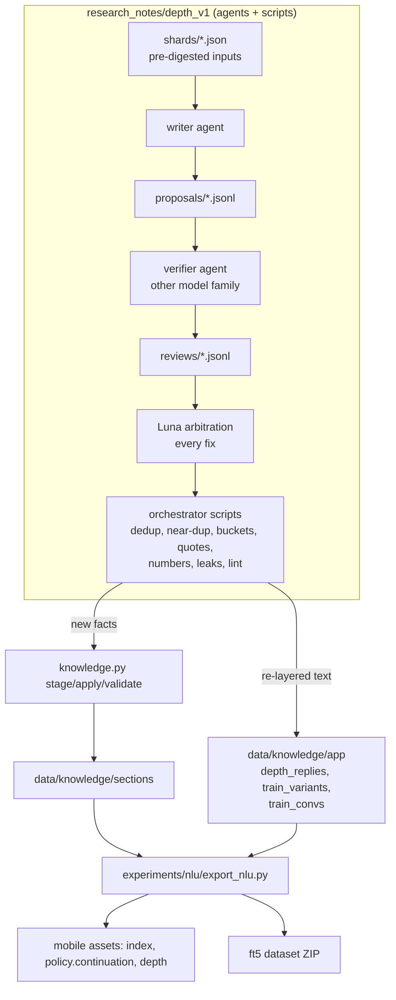
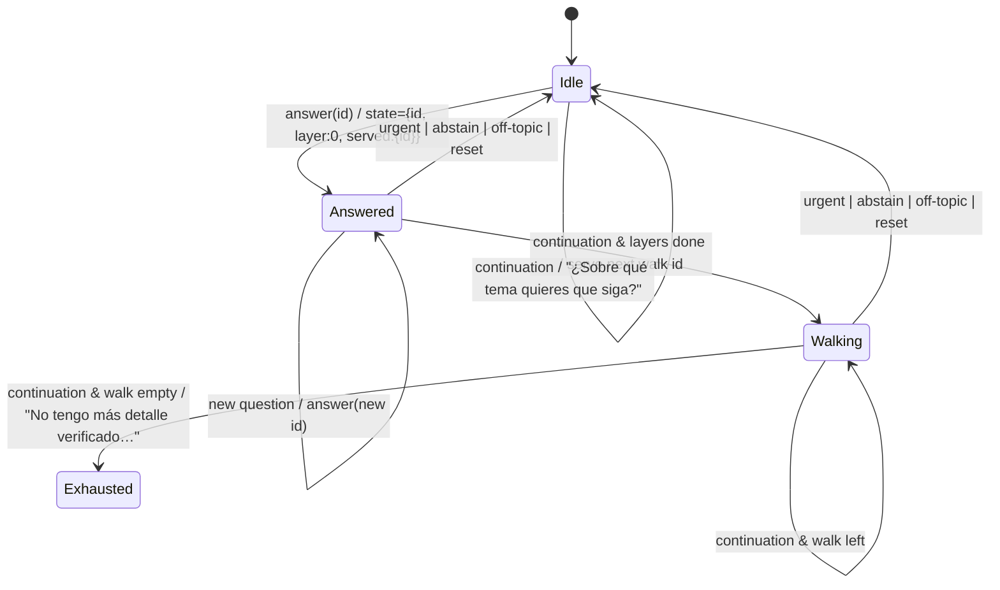

# Design — depth_v1

This design implements `requirements.md`. Where a requirement says "SHALL", this document fixes
the mechanism.

## 1. System view



## 2. Workspace layout

```
research_notes/depth_v1/
  spec/            requirements.md, design.md, tasks.md   (this spec)
  inputs/          T0 digests: headroom.jsonl, detail_overlap.jsonl, followup_failures.jsonl, baseline.json
  shards/          one pre-digested input per child task: <task>_<section>_<n>.json
  proposals/       writer output, one JSONL per shard
  reviews/         verifier output, one JSONL per shard
  judgments/       pair judgments, arbitrations
  blind_v4/        writers' raw, labels, v4_dev.jsonl, v4_sealed.jsonl (+ .sha256)
  decisions/       roster.md, Tn.md gate notes, DECISION_LOG.md
  tools/           orchestrator scripts (below)
  out/             integrated JSON, reports, ft5 ZIP
```

## 3. Row schemas (every row carries `by: "<agent>/<exact model>"`)

```jsonc
// proposals/T4_variants_*.jsonl
{"vid": "v:<entry>:<n>", "entry_id": "...", "text": "...", "bucket": "colloquial|misspelled|fragment|indirect|english|specific_fact", "by": "..."}
// reviews/T4_*.jsonl
{"vid": "...", "verdict": "ok|fix|drop", "fix_entry_id": null, "note": "...", "by": "..."}

// proposals/T5_convs_*.jsonl
{"cid": "c:<entry>:<n>", "entry_id": "...", "type": "related|switch|chain3|elliptic",
 "turns": [{"text": "...", "entry_id": "..."}, {"text": "...", "entry_id": "..."}], "by": "..."}
// reviews/T5_*.jsonl
{"cid": "...", "turn_verdicts": ["ok", "fix:<entry_id>"], "verdict": "ok|fix|drop", "note": "...", "by": "..."}

// proposals/T3_depth_*.jsonl
{"entry_id": "...",
 "layers": [{"kind": "why|how|specifics",
             "sentences": [{"s": "...", "support": ["field:answer.detail" | "quote:<qid>"]}]}],
 "corpus_ops": [ /* knowledge.py op:update with evidence quotes, only for new facts */ ],
 "new_sources": [ /* T3b research only: url, title, quote, retrieved_at */ ],
 "no_headroom_reason": null, "by": "..."}
// reviews/T3_*.jsonl
{"entry_id": "...", "sentence_verdicts": ["supported|partial|unsupported"], "numbers_ok": true,
 "l0_safety_kept": true, "verdict": "ok|fix|drop", "note": "...", "by": "..."}

// proposals/T5b_replies_*.jsonl  (one row per paraphrase)
{"rid": "r:<entry>:<layer>:<n>", "entry_id": "...", "layer": "L0|L1|L2", "text": "...",
 "structure": "direct|context_first|advice_first|question_back", "register": "warm|neutral|brief|explained", "by": "..."}
// reviews/T5b_*.jsonl
{"rid": "...", "same_facts": true, "caveats_kept": true, "natural": true, "verdict": "ok|fix|drop", "fixed_text": null, "note": "...", "by": "..."}

// judgments/pairs_*.jsonl (same contract as the Laya dataset phase)
{"a": "<entry>", "b": "<entry>", "text": "...", "verdict": "distinct|also_answers|query_dependent", "note": "...", "by": "..."}
```

## 4. Integrated outputs (written by script only)

| File | Content | Consumer |
|---|---|---|
| `data/knowledge/app/train_variants.json` | `{entry_id: [text]}`, approved, deduped, leak-free | `finetune.py` / ft5 (training pool) |
| `data/knowledge/app/train_convs.json` | `{entry_id: [[{text, entry_id}, ...]]}` | ft5 multi-turn pairs; `context_eval.py` |
| `data/knowledge/app/depth_replies.json` | `{entry_id: {layers: [{kind, texts: [paraphrases], support}], walk: [ids]}}` | `export_nlu.py` → mobile |
| `data/knowledge/app/reply_variants.json` | `{entry_id: [L0 paraphrases]}`, canonical L0 first, approved only, passed R6.2/R6.3 checks | `export_nlu.py` → mobile |
| `data/knowledge/app/index_additions.json` | variants promoted to the phone index after the A/B (may be empty) | `export_nlu.py` |
| corpus `answer.detail` / `sources` | new facts, through `knowledge.py` only | everything |

`aug_queries.json`, `followup_convs.json` and `natural_replies.json` are **not rewritten**. The new
files sit next to them and are merged by `export_nlu.py`, so a single missing file means today's
behaviour.

## 5. Depth layers

- L0 is today's `natural_replies[id]`. It is never edited.
- L1 (`why` or `how`) and L2 (`specifics`) each have 40–70 words.
- Sources are, in order:
  1. corpus `answer.detail`, `steps`, `variants` and `reflection` facts not used in L0;
  2. quotes from the evidence files of sources the entry already cites;
  3. new public sources found by T3b, applied first through `knowledge.py`.
- `walk`: the entry's `related` ids, then 2-hop related ids, ordered by e5 cosine of label to label.
  Exclude `actions.*` and `kind: chat`. Emergency entries walk only within `health_safety` and
  `actions`.
- Bridge clause templates come from a fixed list in `policy.continuation.bridges` (e.g. "Relacionado
  con esto:"). They carry no facts.

## 6. Runtime (mobile/src/core/knowledge)



- `policy.json` adds `continuation: {cue, max_words: 6, why_cue, bridges, texts: {no_state, exhausted}}`.
  `export_nlu.py` emits it; `null` disables the feature (R4.8).
- `assets.ts`: types and validation for `continuation` and `depth`. Every depth and walk id must be
  in the catalog, or validation fails.
- `engine.ts`:
  - a branch after `detectSafety` and before `embed`;
  - continuation state on the class;
  - the no-repeat guard after `decide`;
  - `prevText` is left untouched on continuation turns.
- **Rotation (R6.5):** the engine keeps `rot: Map<textKey, {order: number[], pos: number}>`, where
  `textKey` is `entry:L0`, `entry:L1` and so on.
  - `order` is a seeded shuffle per session. `pos` advances on every serve.
  - On wrap-around it reshuffles, so that `order[0]` differs from the last text served.
  - Rotation lives for the app session only; `resetContext` keeps it, so the variety survives a
    new chat.
  - Emergency entries rotate only over their double-approved set (R6.6).
- Tests (jest): detector table (≥40 positives and ≥40 near-misses), state machine,
  urgent-clears-state, exhausted text, null policy = today's output byte for byte.
- `tools/e2e_sigue.ts` runs the real engine with a stub embedder that returns the target entry.
  For every one of the 806 entries it sends "ask → sigue ×4" and reports repeats, distinct turns
  and exhaustions. It also sends the same question ×8 and asserts 8 different texts (A11).

## 7. Orchestrator scripts (`research_notes/depth_v1/tools/`)

| Script | Does |
|---|---|
| `digest.py` | builds the T0 inputs and every shard (exact ids, current texts, evidence windows ≤30k tokens per shard) |
| `check_rows.py` | normalised dedup, same-entry near-dup ≥0.93, bucket mix (R1.2/R2.2), continuation lint (R2.4), leak check vs v4 (exact + cos ≥0.93), per-entry counts |
| `pairs.py` | cross-entry cos ≥0.88 → pair-judgment shards of 280 |
| `check_depth.py` | literal quote presence in evidence files, number equality, 40–70 words, L0 hashes of safety/rule entries |
| `check_replies.py` | R6.2: same numbers, units, dates, names and phones as the source text, and every caveat sentence keyword of `kind: safety`/`rule` present. R6.3: trigram Jaccard < 0.55 pairwise, unique first 4 words, ≥3 structures per entry |
| `integrate.py` | reviewed + arbitrated rows → section 4 files, plus `knowledge.py` op files for corpus changes |
| `coverage.py` | acceptance table A1–A4, A8 per entry and per section |
| `package.py` | ft5 ZIP, MANIFEST, clean-extract re-validation (same method as `research_notes/dataset_final/tools/package.py`) |

## 8. Model roster and alternation

OpenCode project agents live in `.opencode/agents/`, with `mode: subagent` and `temperature: 0.2`.
Edit permission is limited to `research_notes/depth_v1/**`.

| Agent | Model | Family |
|---|---|---|
| `nv-go` | `opencode-go/deepseek-v4.1-flash` | DeepSeek |
| `nv-zen` | `opencode/deepseek-v4.1-flash-free` | DeepSeek |
| `nv-luna` | `openai/gpt-6-luna` | Luna |

- Shard *n* even: the writer is DeepSeek (alternating go and zen), the verifier is `nv-luna`.
- Shard *n* odd: the writer is `nv-luna`, the verifier is DeepSeek (alternating zen and go).
- `nv-go` and `nv-zen` are the same model and never verify each other.
- Every `fix` is arbitrated by an `nv-luna` session that did not write or verify that shard.
- If zen is rate-limited 2 times in a row, move the shard to go and log it.

## 9. Ft5 data (prepared, not trained)

- Batch plan: confusable clusters (`confusable_sets.json`, ft4 nearest neighbours of other
  entries, `hard_negatives`). Never put `also_answers` pairs or a hub with its members in one batch.
- Multi-turn anchors: `clean(prev + " " + turn)`, exactly as the engine builds them. The previous
  turn's entry is an explicit negative on `switch` conversations.
- Token lengths of the anchors are measured. If more than 5% exceed 64 tokens, the handoff proposes
  `max_len` 128 as a separate run.
- Runs: ft4 is the control, with one change per run. Selection uses v4-dev only. There is one
  look at v4-sealed, scoring ft4 and ft5 together.

## 10. Rollback

- Corpus: `knowledge.py` transaction backup plus the T0 snapshot (`sections/` sha256).
- App layer: the new files are additive. Deleting them restores today's export.
- Runtime: set `policy.continuation = null`.
